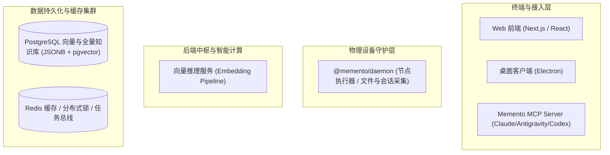

# Code Blueprint: memento

> [!NOTE]
> **Living Blueprint Auto-Generated** · Branch: `main` · Commit: `b915b499` · Updated: `2026-11-28`
> An architectural map of the codebase for AI coding agents (Claude Code, Codex, Antigravity, Cursor, ...).
> Read section 0 first; open other sections by the line ranges it lists instead of reading the whole file.

## 0. 速览与章节索引 (Quick Summary & Section Index)

> 先读这一节定位全局；要细节时按下表行号只读对应章节（Read 的 offset/limit，或 `sed -n 'A,Bp' CODE_BLUEPRINT.md`），不必整份读入。

- 简介 (About): 给你的 AI 工具建个共享大脑与多模态工作台。跨设备、跨工具自动采集 AI 编程对话与记忆，自建后端汇总，内置全能文档与媒体视窗（Office/PPT 16:9 横屏放映、万行表格切片、音视频 GPU 加速），Web + MCP 统一查看、搜索、召回。
- 类型 (Type): Monorepo (Workspaces)
- 技术栈 (Stack): TypeScript/JavaScript, Python, Shell / Bash · React, Electron, Next.js, TailwindCSS, Model Context Protocol (MCP), Docker, Kubernetes / Fleet
- 基础设施 (Infra): PostgreSQL, pgvector (Vector DB), Redis, MinIO / S3 Object Storage, Celery Task Queue
- 规模 (Scale): 9 个子系统 · 1 组 API 路由 / 2 个接口 · 39 个前端页面 · 84 个数据模型 · 35 个服务模块 · 150 个测试文件
- 子系统 (Subsystems): `apps/desktop`, `apps/mobile`, `apps/web`, `packages/core`, `packages/daemon`, `packages/mcp`, `packages/server`, `embedding`, `deploy`
- 自测命令 (Verify): `npm test` ; `npx tsc --noEmit` ; `npm run lint` ; `npm run build`
- 最近改动 (Latest): `0877578c` (2026-11-28): fix(server-ts): 同步 user_memories 反馈归因列到基准 schema.sql
- 业务蓝图 (Business): `BUSINESS_BLUEPRINT.md` · 规则 77（✅ 77 · ⚠️ 0 · ❌ 0）· 流程 9 · 术语 12 · 状态 10 · 最近提交碰到 `R-DOCS-WRITE-LIGHT`, `R-SELF-EVOLVE`, `R-ENT-DEPLOY`, `R-APP-NAME`, `R-ALL-TYPESCRIPT`, `S-CLIENT-VERSION`

| 章节 (Section) | 行号 (Lines) |
| :--- | :--- |
| 1. Project Overview & Tech Stack | L36-L42 |
| 2. High-Level Architecture Topology | L44-L67 |
| 3. Subsystem Breakdown & Responsibilities | L69-L81 |
| 4. Key Entry Points & API Endpoints | L83-L136 |
| 5. Core Domain Services & Background Schedules | L138-L178 |
| 6.5. AST Call Graph, DTO Schemas & CLI Entrypoints | L180-L222 |
| 7. CI/CD Pipelines, Code Hotspots & Test Suites | L224-L268 |
| 8. Development & Verification Commands | L270-L281 |
| 9. Recent Architectural Evolutions | L283-L290 |
| 10. Key Environment Variables & Configuration | L292-L304 |
| 11. 业务蓝图核对 (Business Blueprint Check) | L306-L315 |

## 1. Project Overview & Tech Stack

- **About**: 给你的 AI 工具建个共享大脑与多模态工作台。跨设备、跨工具自动采集 AI 编程对话与记忆，自建后端汇总，内置全能文档与媒体视窗（Office/PPT 16:9 横屏放映、万行表格切片、音视频 GPU 加速），Web + MCP 统一查看、搜索、召回。
- **Project Type**: Monorepo (Workspaces)
- **Core Languages**: TypeScript/JavaScript, Python, Shell / Bash
- **Key Frameworks**: React, Electron, Next.js, TailwindCSS, Model Context Protocol (MCP), Docker, Kubernetes / Fleet
- **Infrastructure & Middleware**: PostgreSQL, pgvector (Vector DB), Redis, MinIO / S3 Object Storage, Celery Task Queue

## 2. High-Level Architecture Topology



## 3. Subsystem Breakdown & Responsibilities

| Subsystem / Path | Category | Role & Purpose |
| :--- | :--- | :--- |
| [`apps/desktop`](apps/desktop) | Application | Memento: the web app in a window, with the local daemon, tray and auto-update |
| [`apps/mobile`](apps/mobile) | Application | Cross-platform mobile client application |
| [`apps/web`](apps/web) | Application | Browser web interface, interactive views, and client assets |
| [`packages/core`](packages/core) | Package / Service | Types, API client and ask stream shared by Memento's web, desktop and mobile clients |
| [`packages/daemon`](packages/daemon) | Package / Service | Memento's local daemon: collects AI tool sessions, runs dispatched agent tasks, keeps the profile and skills in each too |
| [`packages/mcp`](packages/mcp) | Package / Service | Memento memory over MCP (stdio): search, recall, project context, rules, pitfalls, skills and todos |
| [`packages/server`](packages/server) | Package / Service | Memento's server in TypeScript, replacing server/ (Python) route by route: docs/ts-server-migration.md |
| [`embedding`](embedding) | Embedding Microservice | Vector embedding & semantic indexing service |
| [`deploy`](deploy) | Infrastructure & Deployment | Kubernetes kustomization manifests, Fleet GitOps configs, systemd services |

## 4. Key Entry Points & API Endpoints

### Frontend Pages & App Router

- `/`
- `/admin`
- `/app`
- `/ask`
- `/auth/callback`
- `/auth/desktop`
- `/auth/handoff`
- `/auth/login`
- `/auth/register`
- `/collector`
- `/conversations/[id]`
- `/daily`
- `/daily/[date]`
- `/devices`
- `/devices/[deviceId]/tools/[toolId]`
- `/devices/[deviceId]/tools/[toolId]/projects/[projectId]`
- `/documents/[id]`
- `/inbox`
- `/memory`
- `/memory/persona`
- `/plans`
- `/plans/[id]`
- `/plugins`
- `/privacy`
- `/profile`
- `/projects`
- `/projects/[id]`
- `/projects/[id]/conversations`
- `/projects/[id]/timeline`
- `/s/[token]`
- `/search`
- `/skills`
- `/status`
- `/studio`
- `/support`
- `/tasks`
- `/tasks/[id]`
- `/tools`
- `/tools/[tool]`

### Registered API Routers & Endpoints

#### `ipc://electron` (main.ts)

- `IPC boot:retry`
- `IPC boot:use-cloud`

### Core Database Models (`models.py`)

`conversation_messages_removed`, `users`, `machines`, `tools`, `projects`, `daily_summaries`, `invite_codes`, `knowledge_entities`, `share_links`, `ask_conversations`, `user_memories`, `dream_journals`, `user_profiles`, `skills`, `eval_runs`, `learning_evals`, `agent_missions`, `agent_plans`, `user_life_rhythms`, `scheduled_tasks`, `machine_merges`, `documents`, `permissions`, `sync_state`, `knowledge_relations`, `share_views`, `device_tasks`, `correction_topics`, `guard_events`, `document_search`, `conversation_messages`, `document_versions`, `message_audit`, `document_pending_deltas`, `access_logs`, `document_embeddings`, `knowledge_observations`, `correction_events`, `session_reviews`, `todos`, `eval_cases`, `schema_migrations`, `public.access_logs`, `public.agent_missions`, `public.agent_plans`, `public.ask_conversations`, `public.conversation_messages`, `public.conversation_messages_removed`, `public.correction_events`, `public.correction_topics`, `public.daily_summaries`, `public.device_tasks`, `public.document_embeddings`, `public.document_pending_deltas`, `public.document_search`, `public.document_versions`, `public.documents`, `public.dream_journals`, `public.eval_cases`, `public.eval_runs`, `public.guard_events`, `public.invite_codes`, `public.knowledge_entities`, `public.knowledge_observations`, `public.knowledge_relations`, `public.learning_evals`, `public.machine_merges`, `public.machines`, `public.message_audit`, `public.permissions`, `public.projects`, `public.scheduled_tasks`, `public.schema_migrations`, `public.session_reviews`, `public.share_links`, `public.share_views`, `public.skills`, `public.sync_state`, `public.todos`, `public.tools`, `public.user_life_rhythms`, `public.user_memories`, `public.user_profiles`, `public.users`

## 5. Core Domain Services & Background Schedules

### Core Service Layer Modules

| Service Module | Path | Responsibility |
| :--- | :--- | :--- |
| `agent-ids` | [`packages/server/src/services/agent-ids.ts`](packages/server/src/services/agent-ids.ts) | Device OS detection & agent session id validation (server/server/services/agent_ids.py). |
| `agent-limits` | [`packages/server/src/services/agent-limits.ts`](packages/server/src/services/agent-limits.ts) | Detection of agent subscription quota exhaustion (server/server/services/agent_limits.py). |
| `ai-health` | [`packages/server/src/services/ai-health.ts`](packages/server/src/services/ai-health.ts) | AI call health hourly counters & small Redis JSON records (server/server/services/ai_health.py). |
| `ai-provider` | [`packages/server/src/services/ai-provider.ts`](packages/server/src/services/ai-provider.ts) | Multi-provider OpenAI-compatible LLM client with automatic fallback (server/server/services/ai_provider.py). |
| `ai-summary` | [`packages/server/src/services/ai-summary.ts`](packages/server/src/services/ai-summary.ts) | Two-pass daily summary: per-conversation digest -> merged daily report (server/server/services/ai_summary_serv |
| `ask-followups` | [`packages/server/src/services/ask-followups.ts`](packages/server/src/services/ask-followups.ts) | Per-conversation queued follow-ups when a running agent didn't accept mid-run steer (server/server/services/as |
| `ask-prompt` | [`packages/server/src/services/ask-prompt.ts`](packages/server/src/services/ask-prompt.ts) | Prompt construction for Ask: system prompt, history + RAG + Mind Resonance + user profile |
| `ask-retrieval` | [`packages/server/src/services/ask-retrieval.ts`](packages/server/src/services/ask-retrieval.ts) | Hybrid retrieval & Ebbinghaus core-memory recall for /api/ask (server/server/services/ask_retrieval.py). |
| `ask-runs` | [`packages/server/src/services/ask-runs.ts`](packages/server/src/services/ask-runs.ts) | Background Ask runs, SSE replay, cross-replica Redis Stream mirror & rolling handover |
| `ask-store` | [`packages/server/src/services/ask-store.ts`](packages/server/src/services/ask-store.ts) | AskConversation persistence, config inference, session reconciliation & orphaned task recovery |
| `ask-stream` | [`packages/server/src/services/ask-stream.ts`](packages/server/src/services/ask-stream.ts) | Direct agent SSE streaming (with 20ms chunk coalescing, session reconciliation & handover resume) |
| `blueprint-pick` | [`packages/server/src/services/blueprint-pick.ts`](packages/server/src/services/blueprint-pick.ts) | Which of several devices' copies of a project's code blueprint describes the newest code |
| `business-blueprint` | [`packages/server/src/services/business-blueprint.ts`](packages/server/src/services/business-blueprint.ts) | BUSINESS_BLUEPRINT.md parser, rule coverage, resolution & generation dispatch (server/server/services/business |
| `chat-images` | [`packages/server/src/services/chat-images.ts`](packages/server/src/services/chat-images.ts) | Chat images persisted in object storage under /tmp/memento_images/<conv>/<name> (server/server/services/chat_i |
| `claude-session` | [`packages/server/src/services/claude-session.ts`](packages/server/src/services/claude-session.ts) | Claude Code session context & resume-cost metadata (server/server/services/claude_session.py). |
| `cluster` | [`packages/server/src/services/cluster.ts`](packages/server/src/services/cluster.ts) | Cross-replica coordination over Redis, wire-compatible with server/server/services/cluster.py. |
| `content-staging` | [`packages/server/src/services/content-staging.ts`](packages/server/src/services/content-staging.ts) | Content staging for large conversations (server/server/services/content_staging.py). |
| `conversation-parser` | [`packages/server/src/services/conversation-parser.ts`](packages/server/src/services/conversation-parser.ts) | Unified conversation parser for Claude Code, WorkBuddy, Codex, OpenClaw, Antigravity, Cursor, Hermes |
| `correction-service` | [`packages/server/src/services/correction-service.ts`](packages/server/src/services/correction-service.ts) | Learn from user corrections & measure repeat-correction rate (server/server/services/correction_service.py). |
| `device-commands` | [`packages/server/src/services/device-commands.ts`](packages/server/src/services/device-commands.ts) | Redis-backed command queue for collectors (server/server/services/device_commands.py). |
| `device-dispatch` | [`packages/server/src/services/device-dispatch.ts`](packages/server/src/services/device-dispatch.ts) | Handing a device_tasks row to its device over WebSocket (server/server/services/device_dispatch.py). |
| `device-files` | [`packages/server/src/services/device-files.ts`](packages/server/src/services/device-files.ts) | Device file path normalization, RFC 9110 byte-range parsing, and scoped cache helpers (server/server/services/ |
| `device-merge` | [`packages/server/src/services/device-merge.ts`](packages/server/src/services/device-merge.ts) | Device merge resolution (server/server/services/device_merge.py resolve_merged). |
| `device-reports` | [`packages/server/src/services/device-reports.ts`](packages/server/src/services/device-reports.ts) | Device capabilities and AI subscription quotas shared across replicas (server/server/services/device_reports.p |
| `device-service` | [`packages/server/src/services/device-service.ts`](packages/server/src/services/device-service.ts) | Device registration & heartbeat throttling (server/server/services/device_service.py). |
| `dreaming-core` | [`packages/server/src/services/dreaming-core.ts`](packages/server/src/services/dreaming-core.ts) | Core memory markdown export, safe JSON parser & pitfall persistence shared by P4 & P5 |
| `dreaming-service` | [`packages/server/src/services/dreaming-service.ts`](packages/server/src/services/dreaming-service.ts) | Dreaming Consolidation Service: Light -> REM -> Deep -> MEMORY.md & DREAMS.md + Backfill + Bootstrap |
| `dreaming-voice` | [`packages/server/src/services/dreaming-voice.ts`](packages/server/src/services/dreaming-voice.ts) | User voice sanitization, batching & signal extraction for Dreaming & Learning (server/server/services/dreaming |
| `embedding` | [`packages/server/src/services/embedding.ts`](packages/server/src/services/embedding.ts) | Document embeddings, query vector cache & HNSW semantic search (server/server/services/embedding_service.py). |
| `enterprise-policy` | [`packages/server/src/services/enterprise-policy.ts`](packages/server/src/services/enterprise-policy.ts) | Enterprise policy helpers (server/server/services/enterprise_policy.py). |
| `entity-canon` | [`packages/server/src/services/entity-canon.ts`](packages/server/src/services/entity-canon.ts) | Canonical knowledge-graph entity resolution, dedup & stale marking (server/server/services/entity_canon.py). |
| `eval-service` | [`packages/server/src/services/eval-service.ts`](packages/server/src/services/eval-service.ts) | Retrieval evaluation against a frozen grounded question set (server/server/services/eval_service.py). |
| `export` | [`packages/server/src/services/export.ts`](packages/server/src/services/export.ts) | Account-level portable ZIP export, wire-compatible with server/server/services/export_service.py. |
| `fulltext` | [`packages/server/src/services/fulltext.ts`](packages/server/src/services/fulltext.ts) | Keyword matching over document_search through its GIN index with BM25 IDF term weighting (server/server/servic |
| `geoip` | [`packages/server/src/services/geoip.ts`](packages/server/src/services/geoip.ts) | Offline GeoIP lookup (server/server/services/geoip.py). |

## 6.5. AST Call Graph, DTO Schemas & CLI Entrypoints

### Workspace Package Dependency Graph

- `apps/desktop` ➔ `packages/daemon` (`@memento/daemon`)
- `apps/desktop` ➔ `packages/mcp` (`@memento/mcp`)
- `apps/web` ➔ `packages/core` (`@memento/core`)

### AST Cross-Layer Call & Import Graph (Entry ➔ Service / Store)

- `src/embedded-server` ➔ `local-server`
- `src/local-server` ➔ `embedded-server`
- `src/main` ➔ `daemon-host`
- `src/main` ➔ `embedded-server`
- `src/main` ➔ `local-server`
- `src/main` ➔ `helpers`
- `app/+native-intent` ➔ `lib/deeplink`
- `app/_layout` ➔ `lib/session`
- `app/_layout` ➔ `lib/theme`
- `app/index` ➔ `components/GlassSurface`
- `app/index` ➔ `components/Icon`
- `app/index` ➔ `components/ui`
- `app/index` ➔ `lib/deeplink`
- `app/index` ➔ `lib/notifications`
- `app/index` ➔ `lib/session`
- `app/index` ➔ `lib/theme`
- `app/login` ➔ `components/ui`
- `app/login` ➔ `lib/api`
- `app/login` ➔ `lib/session`
- `app/login` ➔ `lib/theme`

### CLI Binaries & Automation Entrypoints

| Command / Script | Category | Path / Target |
| :--- | :--- | :--- |
| `memento-daemon` | Node CLI Binary | `packages/daemon/dist/cli.js` |
| `memento-mcp` | Node CLI Binary | `packages/mcp/dist/cli.js` |
| `brand-icons.mjs` | Automation Script | `scripts/brand-icons.mjs` |
| `check-web-routes.mjs` | Automation Script | `scripts/check-web-routes.mjs` |
| `check_ipv6.sh` | Automation Script | `scripts/check_ipv6.sh` |
| `ddns_ipv6.sh` | Automation Script | `scripts/ddns_ipv6.sh` |
| `fetch_geoip.py` | Automation Script | `scripts/fetch_geoip.py` |
| `project_blueprint.mjs` | Automation Script | `scripts/project_blueprint.mjs` |

## 7. CI/CD Pipelines, Code Hotspots & Test Suites

### CI/CD Workflows & Deployment Manifests

| Category | Name | Path | Details |
| :--- | :--- | :--- | :--- |
| GitHub Actions | `Android APK` | [`.github/workflows/android.yml`](.github/workflows/android.yml) | Jobs: apk |
| GitHub Actions | `Auto Release` | [`.github/workflows/auto-release.yml`](.github/workflows/auto-release.yml) | Jobs: tag-and-release |
| GitHub Actions | `CI` | [`.github/workflows/ci.yml`](.github/workflows/ci.yml) | Jobs: ts-server, ts-client, ts-mobile, ts-web |
| GitHub Actions | `Build & Deploy (k3s via Fleet)` | [`.github/workflows/deploy.yml`](.github/workflows/deploy.yml) | Jobs: changes, wait-ci, build, bump, verify |
| GitHub Actions | `Desktop Release` | [`.github/workflows/desktop-release.yml`](.github/workflows/desktop-release.yml) | Jobs: build-electron, android, publish-release, attach-standalone, attach-apk |
| GitHub Actions | `Embedded Postgres + pgvector` | [`.github/workflows/embedded-pg.yml`](.github/workflows/embedded-pg.yml) | Jobs: build |
| GitHub Actions | `Personal images (stable, multi-arch)` | [`.github/workflows/personal-images.yml`](.github/workflows/personal-images.yml) | Jobs: tags, arm64, stable |
| K8s / GitOps | `gitrepo.yaml` | [`deploy/fleet/gitrepo.yaml`](deploy/fleet/gitrepo.yaml) | Resources: GitRepo |
| K8s / GitOps | `api-ts.yaml` | [`deploy/k8s/api-ts.yaml`](deploy/k8s/api-ts.yaml) | Resources: Deployment, Service |
| K8s / GitOps | `fleet-watchdog.yaml` | [`deploy/k8s/fleet-watchdog.yaml`](deploy/k8s/fleet-watchdog.yaml) | Resources: ServiceAccount, ClusterRole, ClusterRoleBinding, Role, RoleBinding |
| K8s / GitOps | `ingress.yaml` | [`deploy/k8s/ingress.yaml`](deploy/k8s/ingress.yaml) | Resources: Ingress |
| K8s / GitOps | `kustomization.yaml` | [`deploy/k8s/kustomization.yaml`](deploy/k8s/kustomization.yaml) | Resources: Kustomization |
| K8s / GitOps | `migrate-job.yaml` | [`deploy/k8s/migrate-job.yaml`](deploy/k8s/migrate-job.yaml) | Resources: Job |
| K8s / GitOps | `studio.yaml` | [`deploy/k8s/studio.yaml`](deploy/k8s/studio.yaml) | Resources: PersistentVolumeClaim, Deployment, Service |
| K8s / GitOps | `web.yaml` | [`deploy/k8s/web.yaml`](deploy/k8s/web.yaml) | Resources: Deployment, Service |

### Automated Test Suite Matrix

| Suite | Directory | Files | Sample Tests |
| :--- | :--- | :--- | :--- |
| apps/web/test (vitest / jest) | [`apps/web/test`](apps/web/test) | 69 | `active-runs-chip.test.tsx`, `agent-modes.test.ts`, `api-client.test.ts`, `ask-performance-guards.test.tsx`, `ask-reading-and-persona-rules.test.tsx` |
| packages/daemon/test (vitest / jest) | [`packages/daemon/test`](packages/daemon/test) | 67 | `acp-runner.test.ts`, `agent-args.test.ts`, `agent-login.test.ts`, `agent-stream.test.ts`, `agy-background.test.ts` |
| apps/desktop/test (vitest / jest) | [`apps/desktop/test`](apps/desktop/test) | 5 | `embedded-e2e.test.ts`, `embedded-server.test.ts`, `helpers.test.ts`, `local-server.test.ts`, `updater-and-daemon.test.ts` |
| apps/mobile/test (vitest / jest) | [`apps/mobile/test`](apps/mobile/test) | 4 | `deeplink.test.ts`, `glass-surface.test.ts`, `injected-helpers.test.ts`, `webview-props.test.ts` |
| packages/mcp/test (vitest / jest) | [`packages/mcp/test`](packages/mcp/test) | 3 | `remote-and-tools.test.ts`, `server.test.ts`, `task-tools.test.ts` |
| packages/core/test (vitest / jest) | [`packages/core/test`](packages/core/test) | 2 | `ask-stream.test.ts`, `task-events.test.ts` |

### Architectural Hotspots (Top Modified Files in Recent 40 Commits)

- [`packages/server/src/app.ts`](packages/server/src/app.ts) (11 commits)
- [`apps/web/src/app/ask/page.tsx`](apps/web/src/app/ask/page.tsx) (10 commits)
- [`docs/ts-server-migration.md`](docs/ts-server-migration.md) (10 commits)
- [`packages/server/scripts/contract.mts`](packages/server/scripts/contract.mts) (10 commits)
- [`apps/mobile/src/app/index.tsx`](apps/mobile/src/app/index.tsx) (9 commits)
- [`apps/web/src/components/ask/GitDiffDrawer.tsx`](apps/web/src/components/ask/GitDiffDrawer.tsx) (9 commits)
- [`apps/web/src/lib/api-client.ts`](apps/web/src/lib/api-client.ts) (9 commits)
- [`apps/web/test/glass-system.test.ts`](apps/web/test/glass-system.test.ts) (9 commits)
- [`deploy/k8s/ingress.yaml`](deploy/k8s/ingress.yaml) (9 commits)
- [`packages/server/src/main.ts`](packages/server/src/main.ts) (9 commits)

## 8. Development & Verification Commands

```bash
# Unit Tests
npm test
# Typecheck
npx tsc --noEmit
# Code Lint
npm run lint
# Build Package
npm run build
```

## 9. Recent Architectural Evolutions

- `0877578c` (2026-11-28): fix(server-ts): 同步 user_memories 反馈归因列到基准 schema.sql
- `77cf3d77` (2026-11-28): feat(evolution): 全面升级自进化闭环与修复检索评估缺陷
- `3152b57a` (2026-11-28): fix(desktop,server-ts): 修复 Windows cmd AutoRun 导致单机 PG 初始化报错与 pg_ctl 管道挂起并发布 1.0.172
- `cd15e333` (2026-11-28): fix(server-ts,ci): 修复 Linux 内嵌 PG 缺少 pg-symlinks 软链还原并补齐 Linux 压缩包校验
- `d8728321` (2026-11-28): fix(desktop,server-ts): 修复单机内置 PG 动态库绝对软链与 Electron 子进程 Redis 配置并准备发版 1.0.171
- `d4311880` (2026-11-28): fix(mobile,web): 消除底部标签栏毛玻璃发灰并与顶栏及多皮肤色值完全同步

## 10. Key Environment Variables & Configuration

| Variable | Default / Status | Description |
| :--- | :--- | :--- |
| `MEMENTO_SECRET_KEY` | `(required secret)` | Signs JWTs. Must be >= 32 chars, high entropy. |
| `MEMENTO_COLLECTOR_TOKEN` | `(required secret)` | Token used by collectors to register themselves. |
| `POSTGRES_PASSWORD` | `(required secret)` | database URL from it, so it is the only place to set it. |
| `MINIO_ROOT_USER` | `(required secret)` | MinIO / S3 credentials. |
| `MINIO_ROOT_PASSWORD` | `(required secret)` | Environment configuration |
| `ANTHROPIC_API_KEY` | `(required secret)` | Anthropic Claude (reaches the api as MEMENTO_ANTHROPIC_API_KEY). Leave blank to disable. |
| `MEMENTO_AI_API_KEY` | `(required secret)` | Leave blank to disable the alt backend. |
| `MEMENTO_AI_BASE_URL` | `https://coding.dashscope.aliyuncs.com/v1` | Environment configuration |
| `MEMENTO_AI_MODEL` | `kimi-k2.5` | Environment configuration |

## 11. 业务蓝图核对 (Business Blueprint Check)

- 业务蓝图：[BUSINESS_BLUEPRINT.md](BUSINESS_BLUEPRINT.md) · 规则 77（✅ 77 · ⚠️ 0 · ❌ 0）· 流程 9 · 术语 12 · 状态 10
- 结论：✅ 没有失效或违规

### 最近提交碰到的业务条目（改动后复查它们还成不成立）

- `77cf3d77` feat(evolution): 全面升级自进化闭环与修复检索评估缺陷 → `R-DOCS-WRITE-LIGHT`, `R-SELF-EVOLVE`
- `3152b57a` fix(desktop,server-ts): 修复 Windows cmd AutoRun 导致单机 PG 初始化报错与 pg_ctl 管道挂起并发布 1.0 → `R-ENT-DEPLOY`, `R-APP-NAME`, `R-ALL-TYPESCRIPT`, `S-CLIENT-VERSION`
- `cd15e333` fix(server-ts,ci): 修复 Linux 内嵌 PG 缺少 pg-symlinks 软链还原并补齐 Linux 压缩包校验 → `R-ENT-DEPLOY`

---
_Auto-maintained by `scripts/project_blueprint.mjs` (v20261126) & `.git/hooks/(post-commit, post-merge, post-checkout)`. Updates automatically on code modifications, pulls, and branch switches._
