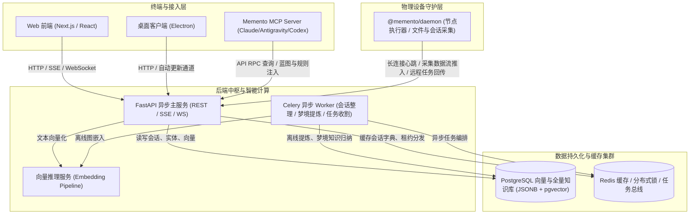
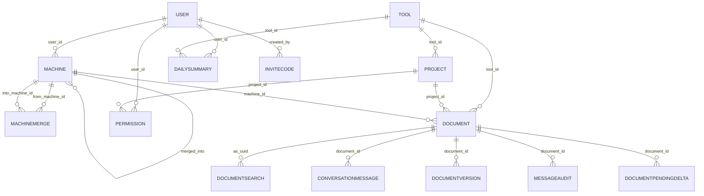

# Project Blueprint: memento

> [!NOTE]
> **Living Blueprint Auto-Generated** · Branch: `main` · Commit: `9f8cdf5b` · Updated: `2026-11-13`
> An architectural map of the codebase for AI coding agents (Claude Code, Codex, Antigravity, Cursor, ...).
> Read section 0 first; open other sections by the line ranges it lists instead of reading the whole file.

## 0. 速览与章节索引 (Quick Summary & Section Index)

> 先读这一节定位全局；要细节时按下表行号只读对应章节（Read 的 offset/limit，或 `sed -n 'A,Bp' PROJECT_BLUEPRINT.md`），不必整份读入。

- 简介 (About): 给你的 AI 工具建个共享大脑与多模态工作台。跨设备、跨工具自动采集 AI 编程对话与记忆，自建后端汇总，内置全能文档与媒体视窗（Office/PPT 16:9 横屏放映、万行表格切片、音视频 GPU 加速），Web + MCP 统一查看、搜索、召回。
- 类型 (Type): Monorepo (Workspaces)
- 技术栈 (Stack): TypeScript/JavaScript, Python, Shell / Bash · React, Electron, Next.js, TailwindCSS, Model Context Protocol (MCP), FastAPI, SQLAlchemy, Celery
- 基础设施 (Infra): PostgreSQL, pgvector (Vector DB), Redis, MinIO / S3 Object Storage, Celery Task Queue
- 规模 (Scale): 9 个子系统 · 35 组 API 路由 / 236 个接口 · 37 个前端页面 · 41 个数据模型 · 35 个服务模块 · 198 个测试文件
- 子系统 (Subsystems): `apps/desktop`, `apps/mobile`, `apps/web`, `packages/core`, `packages/daemon`, `packages/mcp`, `server`, `embedding`, `deploy`
- 自测命令 (Verify): `cd server && uv run pytest -W error::RuntimeWarning` ; `uvx ruff check --isolated --select F server/server` ; `cd apps/web && npx tsc --noEmit && npm test` ; `cd packages/daemon && npm test`
- 最近改动 (Latest): `9f8cdf5b` (2026-11-13): perf(p2p): 工作台的文档、图片、音频、PDF 和续接时的会话文件也走设备直连

| 章节 (Section) | 行号 (Lines) |
| :--- | :--- |
| 1. Project Overview & Tech Stack | L34-L40 |
| 2. High-Level Architecture Topology | L42-L77 |
| 3. Subsystem Breakdown & Responsibilities | L79-L91 |
| 4. Key Entry Points & API Endpoints | L93-L461 |
| 5. Core Domain Services & Background Schedules | L463-L503 |
| 6.5. AST Call Graph, DTO Schemas & CLI Entrypoints | L505-L577 |
| 7. CI/CD Pipelines, Code Hotspots & Test Suites | L579-L620 |
| 8. Development & Verification Commands | L622-L639 |
| 9. Recent Architectural Evolutions | L641-L648 |
| 10. Key Environment Variables & Configuration | L650-L662 |

## 1. Project Overview & Tech Stack

- **About**: 给你的 AI 工具建个共享大脑与多模态工作台。跨设备、跨工具自动采集 AI 编程对话与记忆，自建后端汇总，内置全能文档与媒体视窗（Office/PPT 16:9 横屏放映、万行表格切片、音视频 GPU 加速），Web + MCP 统一查看、搜索、召回。
- **Project Type**: Monorepo (Workspaces)
- **Core Languages**: TypeScript/JavaScript, Python, Shell / Bash
- **Key Frameworks**: React, Electron, Next.js, TailwindCSS, Model Context Protocol (MCP), FastAPI, SQLAlchemy, Celery, Pydantic, Docker, Kubernetes / Fleet
- **Infrastructure & Middleware**: PostgreSQL, pgvector (Vector DB), Redis, MinIO / S3 Object Storage, Celery Task Queue

## 2. High-Level Architecture Topology



## 3. Subsystem Breakdown & Responsibilities

| Subsystem / Path | Category | Role & Purpose |
| :--- | :--- | :--- |
| [`apps/desktop`](apps/desktop) | Application | Memento: the web app in a window, with the local daemon, tray and auto-update |
| [`apps/mobile`](apps/mobile) | Application | Cross-platform mobile client application |
| [`apps/web`](apps/web) | Application | Browser web interface, interactive views, and client assets |
| [`packages/core`](packages/core) | Package / Service | Types, API client and ask stream shared by Memento's web, desktop and mobile clients |
| [`packages/daemon`](packages/daemon) | Package / Service | Memento's local daemon: collects AI tool sessions, runs dispatched agent tasks, keeps the profile and skills in each too |
| [`packages/mcp`](packages/mcp) | Package / Service | Memento memory over MCP (stdio): search, recall, project context, rules, pitfalls, skills and todos |
| [`server`](server) | Backend API Service | FastAPI backend services, database models, background Celery workers |
| [`embedding`](embedding) | Embedding Microservice | Vector embedding & semantic indexing service |
| [`deploy`](deploy) | Infrastructure & Deployment | Kubernetes kustomization manifests, Fleet GitOps configs, systemd services |

## 4. Key Entry Points & API Endpoints

### Frontend Pages & App Router

- `/`
- `/admin`
- `/app`
- `/ask`
- `/auth/callback`
- `/auth/desktop`
- `/auth/handoff`
- `/auth/login`
- `/auth/register`
- `/collector`
- `/conversations/[id]`
- `/daily`
- `/daily/[date]`
- `/devices`
- `/devices/[deviceId]/tools/[toolId]`
- `/devices/[deviceId]/tools/[toolId]/projects/[projectId]`
- `/documents/[id]`
- `/inbox`
- `/memory`
- `/memory/persona`
- `/plans`
- `/plans/[id]`
- `/privacy`
- `/profile`
- `/projects`
- `/projects/[id]`
- `/projects/[id]/conversations`
- `/projects/[id]/timeline`
- `/s/[token]`
- `/search`
- `/skills`
- `/status`
- `/support`
- `/tasks`
- `/tasks/[id]`
- `/tools`
- `/tools/[tool]`

### Registered API Routers & Endpoints

#### `/api/admin` (admin.py)

- `GET /api/admin/users`
- `POST /api/admin/users/{user_id}/approve`
- `PUT /api/admin/users/{user_id}`
- `POST /api/admin/users/{user_id}/rotate-collector-token`
- `POST /api/admin/users/{user_id}/transfer-ownership`
- _... (9 more endpoints)_

#### `/api/ask` (ask.py)

- `POST /api/ask/warmup`
- `GET /api/ask/runs`
- `GET /api/ask/runs/active`
- `GET /api/ask/conversations/{conv_id}/run`
- `GET /api/ask/conversations/{conv_id}/stream`
- _... (8 more endpoints)_

#### `/ask_conversations` (ask_conversations.py)

- `GET /ask_conversations/conversations`
- `GET /ask_conversations/conversations/recent-active`
- `GET /ask_conversations/conversations/{conv_id}`
- `POST /ask_conversations/conversations/ensure-by-session`
- `PATCH /ask_conversations/conversations/{conv_id}`
- _... (1 more endpoints)_

#### `/api/auth` (auth.py)

- `GET /api/auth/registration-mode`
- `POST /api/auth/register`
- `POST /api/auth/token-exchange`
- `POST /api/auth/refresh`
- `POST /api/auth/login`
- _... (11 more endpoints)_

#### `/api/conversations` (conversations.py)

- `GET /api/conversations/{doc_id}`
- `GET /api/conversations/{doc_id}/messages`
- `PATCH /api/conversations/{doc_id}`
- `GET /api/conversations/{session_id}/stats`
- `POST /api/conversations/{session_id}/compact`

#### `/api/daily` (daily.py)

- `GET /api/daily`
- `GET /api/daily/{date_str}`
- `GET /api/daily/{date_str}/messages`
- `GET /api/daily/{date_str}/summary`
- `POST /api/daily/{date_str}/generate-summary`

#### `/api/dashboard` (dashboard.py)

- `GET /api/dashboard`

#### `/api/data` (data_io.py)

- `GET /api/data/export`
- `POST /api/data/import`

#### `/api/devices` (devices.py)

- `GET /api/devices`
- `GET /api/devices/{device_db_id}/discovery`
- `DELETE /api/devices/{device_db_id}`
- `POST /api/devices/{device_db_id}/archive`
- `POST /api/devices/{device_db_id}/unarchive`
- _... (7 more endpoints)_

#### `/api/documents` (documents.py)

- `GET /api/documents/proxy-fetch`
- `GET /api/documents/{doc_id}`
- `GET /api/documents/{doc_id}/backlinks`

#### `/api/events` (events.py)

- `GET /api/events/stream`

#### `/api/health` (health.py)

- `GET /api/health/overview`

#### `/api/hierarchy` (hierarchy.py)

- `GET /api/hierarchy/devices`
- `GET /api/hierarchy/devices/{device_id}/tools`
- `GET /api/hierarchy/devices/{device_id}/tools/{tool_id}/projects`
- `GET /api/hierarchy/devices/{device_id}/tools/{tool_id}/files`

#### `/api/ingest` (ingest.py)

- `POST /api/ingest/file`
- `POST /api/ingest/files`
- `POST /api/ingest/reconcile`
- `POST /api/ingest/discovery`
- `POST /api/ingest/heartbeat`
- _... (1 more endpoints)_

#### `/install_bootstrap` (install_bootstrap.py)

- `GET /install_bootstrap/install.sh`
- `GET /install_bootstrap/install.ps1`
- `GET /install_bootstrap/install/executor.sh`
- `GET /install_bootstrap/install`
- `GET /install_bootstrap/install`
- _... (1 more endpoints)_

#### `/api/learning` (learning.py)

- `GET /api/learning/corrections`
- `POST /api/learning/corrections/{topic_id}/accept`
- `POST /api/learning/corrections/{topic_id}/dismiss`
- `GET /api/learning/check`
- `POST /api/learning/review`
- _... (10 more endpoints)_

#### `/api/life` (life_rhythm.py)

- `GET /api/life/rhythm`
- `POST /api/life/rhythm/sync`
- `POST /api/life/rhythm`
- `POST /api/life/rhythm/parse-image`
- `POST /api/life/rhythm/ocr`
- _... (4 more endpoints)_

#### `/api/profile/llm` (llm.py)

- `GET /api/profile/llm`
- `PUT /api/profile/llm`
- `GET /api/profile/llm/agent`
- `PUT /api/profile/llm/agent`
- `POST /api/profile/llm/test`

#### `/api/media` (media.py)

- `GET /api/media/image/{key:path}`

#### `/api/memory` (memory.py)

- `GET /api/memory/stats`
- `GET /api/memory/resonance`
- `GET /api/memory/graph`
- `GET /api/memory/entities/{entity_id}`
- `GET /api/memory/search`
- _... (17 more endpoints)_

#### `/api/missions` (missions.py)

- `GET /api/missions`
- `POST /api/missions`
- `GET /api/missions/{mission_id}`
- `GET /api/missions/{mission_id}/approve`
- `POST /api/missions/{mission_id}/approve`
- _... (1 more endpoints)_

#### `/api/notify` (notify.py)

- `GET /api/notify/settings`
- `PUT /api/notify/settings`
- `POST /api/notify/device-token`
- `DELETE /api/notify/device-token`
- `POST /api/notify/live-activity-token`
- _... (3 more endpoints)_

#### `/api/plans` (plans.py)

- `POST /api/plans`
- `GET /api/plans`
- `GET /api/plans/capabilities`
- `GET /api/plans/{plan_id}`
- `POST /api/plans/{plan_id}/start`
- _... (5 more endpoints)_

#### `/api/proactive` (proactive.py)

- `GET /api/proactive/settings`
- `PUT /api/proactive/settings`
- `POST /api/proactive/test-morning-brief`
- `POST /api/proactive/test-evening-reflection`

#### `/api/profile` (profile.py)

- `PUT /api/profile/blueprint/settings`
- `PUT /api/profile/pitfalls/settings`
- `POST /api/profile/blueprint/status`
- `POST /api/profile/mcp/status`
- `GET /api/profile/blueprint`
- _... (14 more endpoints)_

#### `/api/projects` (projects.py)

- `GET /api/projects`
- `GET /api/projects/{project_id}`
- `PATCH /api/projects/{project_id}`
- `GET /api/projects/{project_id}/timeline`
- `GET /api/projects/{project_id}/conversations`
- _... (2 more endpoints)_

#### `/api/public` (public.py)

- `GET /api/public/stats`

#### `/api/agent/quotas` (quotas.py)

- `GET /api/agent/quotas`
- `POST /api/agent/quotas/refresh`

#### `/api/search` (search.py)

- `GET /api/search`

#### `/api/share` (share.py)

- `POST /api/share`
- `GET /api/share`
- `GET /api/share/recipients`
- `GET /api/share/inbox`
- `GET /api/share/{token}/views`
- _... (3 more endpoints)_

#### `/api/skills` (skills.py)

- `GET /api/skills`
- `PUT /api/skills/{skill_id}`
- `POST /api/skills/{skill_id}/publish`
- `POST /api/skills/{skill_id}/dismiss`
- `POST /api/skills/{skill_id}/retire`
- _... (5 more endpoints)_

#### `/api/tasks` (tasks.py)

- `POST /api/tasks/dispatch/{device_id}`
- `GET /api/tasks`
- `GET /api/tasks/{task_id}`
- `POST /api/tasks/{task_id}/cancel`
- `POST /api/tasks/{task_id}/input`
- _... (1 more endpoints)_

#### `/api/todos` (todos.py)

- `GET /api/todos`
- `POST /api/todos`
- `PUT /api/todos/{todo_id}`

#### `/api/tools` (tools.py)

- `GET /api/tools`
- `GET /api/tools/{tool_id}`
- `GET /api/tools/{tool_id}/files`

#### `/api/system/update` (updates.py)

- `GET /api/system/update/check`

### Core Database Models (`models.py`)

`Base`, `Machine`, `MachineMerge`, `Tool`, `Project`, `Document`, `DocumentSearch`, `ConversationMessage`, `DailySummary`, `DocumentVersion`, `ConversationMessageRemoved`, `MessageAudit`, `DocumentPendingDelta`, `User`, `InviteCode`, `Permission`, `AccessLog`, `SyncState`, `DocumentEmbedding`, `KnowledgeEntity`, `KnowledgeRelation`, `KnowledgeObservation`, `ShareLink`, `ShareView`, `DeviceTask`, `AskConversation`, `UserMemory`, `DreamJournal`, `UserProfile`, `CorrectionTopic`, `CorrectionEvent`, `SessionReview`, `GuardEvent`, `Skill`, `Todo`, `EvalCase`, `EvalRun`, `LearningEval`, `AgentMission`, `AgentPlan`, `UserLifeRhythm`

#### Key Entity Relationships (Foreign Keys)



- `Machine.user_id` ➔ `users.id`
- `Machine.merged_into` ➔ `machines.id`
- `MachineMerge.from_machine_id` ➔ `machines.id`
- `MachineMerge.into_machine_id` ➔ `machines.id`
- `Project.tool_id` ➔ `tools.id`
- `Document.tool_id` ➔ `tools.id`
- `Document.project_id` ➔ `projects.id`
- `Document.machine_id` ➔ `machines.id`
- `DocumentSearch.as_uuid` ➔ `documents.id`
- `ConversationMessage.document_id` ➔ `documents.id`
- `DailySummary.user_id` ➔ `users.id`
- `DailySummary.tool_id` ➔ `tools.id`
- `DocumentVersion.document_id` ➔ `documents.id`
- `MessageAudit.document_id` ➔ `documents.id`
- `DocumentPendingDelta.document_id` ➔ `documents.id`
- `InviteCode.created_by` ➔ `users.id`
- `Permission.user_id` ➔ `users.id`
- `Permission.project_id` ➔ `projects.id`
- `Permission.tool_id` ➔ `tools.id`
- `Permission.granted_by` ➔ `users.id`
- `AccessLog.user_id` ➔ `users.id`
- `AccessLog.document_id` ➔ `documents.id`
- `SyncState.machine_id` ➔ `machines.id`
- `SyncState.tool_id` ➔ `tools.id`
- `DocumentEmbedding.document_id` ➔ `documents.id`

#### Deduplication & Uniqueness Constraints

- `Project.slug` (unique)
- `User.email` (unique)
- `User.collector_token` (unique)
- `User.wechat_openid` (unique)
- `InviteCode.code` (unique)
- `DocumentEmbedding`: unique(document_id, chunk_index)
- `KnowledgeEntity`: unique(user_id, name, entity_type)
- `ShareLink.token` (unique)
- `UserMemory`: unique(user_id, category, key)
- `UserProfile`: unique(user_id, version)
- `CorrectionEvent`: unique(user_id, fingerprint)
- `Skill`: unique(user_id, slug)
- `LearningEval`: unique(user_id, week)

## 5. Core Domain Services & Background Schedules

### Core Service Layer Modules

| Service Module | Path | Responsibility |
| :--- | :--- | :--- |
| `agent_limits` | [`server/server/services/agent_limits.py`](server/server/services/agent_limits.py) | An agent's own report that the account's quota ran out: the run then reads as that, not as done, |
| `ai_health` | [`server/server/services/ai_health.py`](server/server/services/ai_health.py) | AI call health: hourly counters in Redis, read back by the health page and alerts. |
| `ai_provider` | [`server/server/services/ai_provider.py`](server/server/services/ai_provider.py) | AI Provider service — multi-provider fallback client. |
| `ai_summary_service` | [`server/server/services/ai_summary_service.py`](server/server/services/ai_summary_service.py) | AI summary service — two-pass daily summary: per-conversation digest → merged daily report. |
| `ask_followups` | [`server/server/services/ask_followups.py`](server/server/services/ask_followups.py) | Follow-ups the running agent didn't take, kept per conversation until the next message carries them. |
| `ask_prompt` | [`server/server/services/ask_prompt.py`](server/server/services/ask_prompt.py) | Prompt assembly for /api/ask: the system prompt, the history window, and |
| `ask_retrieval` | [`server/server/services/ask_retrieval.py`](server/server/services/ask_retrieval.py) | Retrieval for /api/ask: hybrid keyword + vector ranking over the user's |
| `ask_runs` | [`server/server/services/ask_runs.py`](server/server/services/ask_runs.py) | Ask runs that outlive the HTTP request that started them. |
| `ask_store` | [`server/server/services/ask_store.py`](server/server/services/ask_store.py) | Persistence for /api/ask conversations: finding or creating them, appending |
| `ask_stream` | [`server/server/services/ask_stream.py`](server/server/services/ask_stream.py) | Streaming for /api/ask: the direct-agent SSE stream and the response that |
| `blueprint_pick` | [`server/server/services/blueprint_pick.py`](server/server/services/blueprint_pick.py) | Which of several devices' copies of a project's PROJECT_BLUEPRINT.md describes the newest code. |
| `cache` | [`server/server/services/cache.py`](server/server/services/cache.py) | Tiered L1 (in-process memory) and L2 (Redis-backed) JSON cache for hot read endpoints. |
| `claude_session` | [`server/server/services/claude_session.py`](server/server/services/claude_session.py) | What resuming a Claude Code session will cost, read from its own transcript. |
| `cluster` | [`server/server/services/cluster.py`](server/server/services/cluster.py) | Coordination between api replicas over Redis. |
| `content_staging` | [`server/server/services/content_staging.py`](server/server/services/content_staging.py) | Appending to a big conversation without rewriting it on every sync. |
| `conversation_parser` | [`server/server/services/conversation_parser.py`](server/server/services/conversation_parser.py) | Unified conversation parser — normalizes different JSONL formats into a common structure. |
| `correction_service` | [`server/server/services/correction_service.py`](server/server/services/correction_service.py) | Learn from corrections as they happen, and measure whether the learning sticks. |
| `device_commands` | [`server/server/services/device_commands.py`](server/server/services/device_commands.py) | Commands for a collector, picked up on its next poll (GET /api/devices/commands). |
| `device_dispatch` | [`server/server/services/device_dispatch.py`](server/server/services/device_dispatch.py) | Handing a device_tasks row to its device. |
| `device_merge` | [`server/server/services/device_merge.py`](server/server/services/device_merge.py) | One computer, one device record. |
| `device_reports` | [`server/server/services/device_reports.py`](server/server/services/device_reports.py) | What connected devices report about themselves: agent capabilities (tools, |
| `device_service` | [`server/server/services/device_service.py`](server/server/services/device_service.py) | Device service — registers and updates collector devices. |
| `dreaming_service` | [`server/server/services/dreaming_service.py`](server/server/services/dreaming_service.py) | Dreaming Consolidation Service — Autonomous Memory Tiering & Sleep Replay. |
| `embedding_service` | [`server/server/services/embedding_service.py`](server/server/services/embedding_service.py) | Embeddings for documents: chunk the text, embed only the chunks that changed. |
| `entity_canon` | [`server/server/services/entity_canon.py`](server/server/services/entity_canon.py) | One knowledge-graph entity per thing. |
| `eval_service` | [`server/server/services/eval_service.py`](server/server/services/eval_service.py) | Retrieval evaluation: does Memento still find the right document? |
| `export_service` | [`server/server/services/export_service.py`](server/server/services/export_service.py) | Account-level data export — builds a portable ZIP of the caller's own data. |
| `fulltext` | [`server/server/services/fulltext.py`](server/server/services/fulltext.py) | Keyword matching over document_search: through its GIN index, with query terms weighted by rarity. |
| `geoip` | [`server/server/services/geoip.py`](server/server/services/geoip.py) | Offline GeoIP lookup — reads a MaxMind/DB-IP .mmdb file from disk. |
| `graph_service` | [`server/server/services/graph_service.py`](server/server/services/graph_service.py) | Knowledge graph auto-extraction — extracts entities and relations from conversations using LLM. |
| `guard_service` | [`server/server/services/guard_service.py`](server/server/services/guard_service.py) | Completion check: the Stop hook the collector installs in Claude Code and Codex. |
| `guidance_service` | [`server/server/services/guidance_service.py`](server/server/services/guidance_service.py) | What an AI should know before it acts: the user's rules, past pitfalls, and learned skills. |
| `health_service` | [`server/server/services/health_service.py`](server/server/services/health_service.py) | System health overview: is the learning loop actually working? |
| `import_service` | [`server/server/services/import_service.py`](server/server/services/import_service.py) | Account-level data import — restore a memento-export ZIP into the |
| `ingest_service` | [`server/server/services/ingest_service.py`](server/server/services/ingest_service.py) | Ingest service — processes incoming files from the collector. |

## 6.5. AST Call Graph, DTO Schemas & CLI Entrypoints

### Workspace Package Dependency Graph

- `apps/desktop` ➔ `packages/daemon` (`@memento/daemon`)
- `apps/desktop` ➔ `packages/mcp` (`@memento/mcp`)
- `apps/web` ➔ `packages/core` (`@memento/core`)

### AST Cross-Layer Call & Import Graph (Entry ➔ Service / Store)

- `api/admin` ➔ `models/AccessLog`
- `api/admin` ➔ `models/ConversationMessage`
- `api/admin` ➔ `models/Document`
- `api/admin` ➔ `models/DocumentEmbedding`
- `api/admin` ➔ `models/DocumentVersion`
- `api/admin` ➔ `models/InviteCode`
- `api/admin` ➔ `models/KnowledgeEntity`
- `api/admin` ➔ `models/KnowledgeObservation`
- `api/admin` ➔ `models/KnowledgeRelation`
- `api/admin` ➔ `models/Machine`
- `api/admin` ➔ `models/Permission`
- `api/admin` ➔ `models/Project`
- `api/admin` ➔ `models/SyncState`
- `api/admin` ➔ `models/Tool`
- `api/admin` ➔ `models/User`
- `api/admin` ➔ `db/session`
- `api/ask` ➔ `models/Machine`
- `api/ask` ➔ `models/User`
- `api/ask` ➔ `db/session`
- `api/ask` ➔ `services/ai_provider`

### Key Request / Response DTO & OpenAPI Schemas

| Schema Name | Type | Source File | Core Fields |
| :--- | :--- | :--- | :--- |
| `UserUpdateRequest` | Pydantic DTO | [`server/server/api/admin.py`](server/server/api/admin.py) | `role: str \| None`, `status: str \| None` |
| `InviteCreateRequest` | Pydantic DTO | [`server/server/api/admin.py`](server/server/api/admin.py) | `max_uses: int`, `expires_days: int \| None`, `role_on_accept: str`, `note: str \| None` |
| `GrantPermissionRequest` | Pydantic DTO | [`server/server/api/admin.py`](server/server/api/admin.py) | `user_id: str`, `project_id: str \| None`, `tool_id: str \| None`, `permission: str` |
| `AskRequest` | Pydantic DTO | [`server/server/api/ask.py`](server/server/api/ask.py) | `question: str`, `conversation_id: str \| None`, `request_id: str \| None`, `history: list[dict] \| None`, `tool: str \| None`, `days: int \| None` |
| `FollowUpRequest` | Pydantic DTO | [`server/server/api/ask.py`](server/server/api/ask.py) | `text: str` |
| `EnsureConversationBySessionRequest` | Pydantic DTO | [`server/server/api/ask_conversations.py`](server/server/api/ask_conversations.py) | `session_id: str`, `project_id: str \| None`, `execution_mode: str \| None`, `device_id: str \| None`, `cwd: str \| None` |
| `UpdateConversationRequest` | Pydantic DTO | [`server/server/api/ask_conversations.py`](server/server/api/ask_conversations.py) | `title: str \| None`, `device_id: str \| None`, `cwd: str \| None`, `execution_mode: str \| None`, `model: str \| None`, `effort: str \| None` |
| `RegisterRequest` | Pydantic DTO | [`server/server/api/auth.py`](server/server/api/auth.py) | `email: str`, `password: str`, `name: str \| None`, `invite_code: str \| None` |
| `RegistrationModeResponse` | Pydantic DTO | [`server/server/api/auth.py`](server/server/api/auth.py) | `mode: str`, `has_any_user: bool`, `github_enabled: bool`, `wechat_enabled: bool` |
| `LoginRequest` | Pydantic DTO | [`server/server/api/auth.py`](server/server/api/auth.py) | `email: str`, `password: str` |
| `TokenResponse` | Pydantic DTO | [`server/server/api/auth.py`](server/server/api/auth.py) | `access_token: str`, `token_type: str`, `user_id: str`, `role: str` |
| `UserResponse` | Pydantic DTO | [`server/server/api/auth.py`](server/server/api/auth.py) | `id: str`, `email: str`, `name: str \| None`, `role: str`, `status: str`, `collector_token: str \| None` |
| `UpdateProfileRequest` | Pydantic DTO | [`server/server/api/auth.py`](server/server/api/auth.py) | `name: str \| None`, `avatar_url: str \| None` |
| `ConversationUpdate` | Pydantic DTO | [`server/server/api/conversations.py`](server/server/api/conversations.py) | `title: str` |
| `CompactRequest` | Pydantic DTO | [`server/server/api/conversations.py`](server/server/api/conversations.py) | `recent_turns: int`, `new_prompt: str` |
| `P2POffer` | Pydantic DTO | [`server/server/api/devices.py`](server/server/api/devices.py) | `sdp: str` |
| `AgentLoginBody` | Pydantic DTO | [`server/server/api/devices.py`](server/server/api/devices.py) | `action: str`, `agent: str`, `code: str` |
| `IngestFileRequest` | Pydantic DTO | [`server/server/api/ingest.py`](server/server/api/ingest.py) | `tool: str`, `category: str`, `content_type: str`, `relative_path: str`, `hash: str`, `mode: str` |
| `IngestResponse` | Pydantic DTO | [`server/server/api/ingest.py`](server/server/api/ingest.py) | `status: str`, `document_id: str`, `message: str`, `next_offset: int \| None` |
| `IngestFilesRequest` | Pydantic DTO | [`server/server/api/ingest.py`](server/server/api/ingest.py) | `files: list[IngestFileRequest]` |
| `ReconcileFile` | Pydantic DTO | [`server/server/api/ingest.py`](server/server/api/ingest.py) | `tool: str`, `relative_path: str`, `offset: int` |
| `ReconcileRequest` | Pydantic DTO | [`server/server/api/ingest.py`](server/server/api/ingest.py) | `files: list[ReconcileFile]` |
| `AcceptBody` | Pydantic DTO | [`server/server/api/learning.py`](server/server/api/learning.py) | `statement: str \| None`, `general: bool` |
| `PitfallBody` | Pydantic DTO | [`server/server/api/learning.py`](server/server/api/learning.py) | `title: str`, `symptom: str`, `fix: str`, `cause: str \| None`, `project: str \| None` |
| `GuardBody` | Pydantic DTO | [`server/server/api/learning.py`](server/server/api/learning.py) | `enabled: bool` |

### CLI Binaries & Automation Entrypoints

| Command / Script | Category | Path / Target |
| :--- | :--- | :--- |
| `memento-daemon` | Node CLI Binary | `packages/daemon/dist/cli.js` |
| `memento-mcp` | Node CLI Binary | `packages/mcp/dist/cli.js` |
| `brand-icons.mjs` | Automation Script | `scripts/brand-icons.mjs` |
| `check-web-routes.mjs` | Automation Script | `scripts/check-web-routes.mjs` |
| `check_ipv6.sh` | Automation Script | `scripts/check_ipv6.sh` |
| `ddns_ipv6.sh` | Automation Script | `scripts/ddns_ipv6.sh` |
| `fetch_geoip.py` | Automation Script | `scripts/fetch_geoip.py` |
| `project_blueprint.mjs` | Automation Script | `scripts/project_blueprint.mjs` |

## 7. CI/CD Pipelines, Code Hotspots & Test Suites

### CI/CD Workflows & Deployment Manifests

| Category | Name | Path | Details |
| :--- | :--- | :--- | :--- |
| GitHub Actions | `Android APK` | [`.github/workflows/android.yml`](.github/workflows/android.yml) | Jobs: apk |
| GitHub Actions | `Auto Release` | [`.github/workflows/auto-release.yml`](.github/workflows/auto-release.yml) | Jobs: tag-and-release |
| GitHub Actions | `CI` | [`.github/workflows/ci.yml`](.github/workflows/ci.yml) | Jobs: python, ts-client, ts-mobile, ts-web |
| GitHub Actions | `Build & Deploy (k3s via Fleet)` | [`.github/workflows/deploy.yml`](.github/workflows/deploy.yml) | Jobs: changes, wait-ci, build, bump, verify |
| GitHub Actions | `Desktop Release` | [`.github/workflows/desktop-release.yml`](.github/workflows/desktop-release.yml) | Jobs: build-electron, android, publish-release, attach-apk |
| K8s / GitOps | `gitrepo.yaml` | [`deploy/fleet/gitrepo.yaml`](deploy/fleet/gitrepo.yaml) | Resources: GitRepo |
| K8s / GitOps | `api.yaml` | [`deploy/k8s/api.yaml`](deploy/k8s/api.yaml) | Resources: Deployment, Service |
| K8s / GitOps | `celery.yaml` | [`deploy/k8s/celery.yaml`](deploy/k8s/celery.yaml) | Resources: Deployment |
| K8s / GitOps | `ingress.yaml` | [`deploy/k8s/ingress.yaml`](deploy/k8s/ingress.yaml) | Resources: Ingress |
| K8s / GitOps | `kustomization.yaml` | [`deploy/k8s/kustomization.yaml`](deploy/k8s/kustomization.yaml) | Resources: Kustomization |
| K8s / GitOps | `web.yaml` | [`deploy/k8s/web.yaml`](deploy/k8s/web.yaml) | Resources: Deployment, Service |

### Automated Test Suite Matrix

| Suite | Directory | Files | Sample Tests |
| :--- | :--- | :--- | :--- |
| server/tests (pytest) | [`server/tests`](server/tests) | 109 | `test_agent_limits.py`, `test_agent_login.py`, `test_agent_run_states.py`, `test_ai_provider.py`, `test_artifact_media_stream.py` |
| packages/daemon/test (vitest / jest) | [`packages/daemon/test`](packages/daemon/test) | 53 | `agent-args.test.ts`, `agent-login.test.ts`, `agent-stream.test.ts`, `agy-models.test.ts`, `antigravity-app-quota.test.ts` |
| apps/web/test (vitest / jest) | [`apps/web/test`](apps/web/test) | 30 | `api-client.test.ts`, `ask-top-bar.test.tsx`, `auth-fetch.test.ts`, `build-update.test.ts`, `cache-writes.test.ts` |
| apps/mobile/test (vitest / jest) | [`apps/mobile/test`](apps/mobile/test) | 2 | `deeplink.test.ts`, `webview-props.test.ts` |
| packages/core/test (vitest / jest) | [`packages/core/test`](packages/core/test) | 2 | `ask-stream.test.ts`, `task-events.test.ts` |
| apps/desktop/test (vitest / jest) | [`apps/desktop/test`](apps/desktop/test) | 1 | `helpers.test.ts` |
| packages/mcp/test (vitest / jest) | [`packages/mcp/test`](packages/mcp/test) | 1 | `server.test.ts` |

### Architectural Hotspots (Top Modified Files in Recent 40 Commits)

- [`packages/daemon/assets/workbuddy_cli.mjs`](packages/daemon/assets/workbuddy_cli.mjs) (16 commits)
- [`packages/daemon/src/task-runner.ts`](packages/daemon/src/task-runner.ts) (14 commits)
- [`apps/web/src/app/ask/page.tsx`](apps/web/src/app/ask/page.tsx) (13 commits)
- [`apps/web/src/lib/api-client.ts`](apps/web/src/lib/api-client.ts) (8 commits)
- [`server/server/services/plan_service.py`](server/server/services/plan_service.py) (7 commits)
- [`server/tests/test_plan_service.py`](server/tests/test_plan_service.py) (7 commits)
- [`packages/daemon/src/agent-stream.ts`](packages/daemon/src/agent-stream.ts) (6 commits)
- [`apps/web/src/components/TaskTimeline.tsx`](apps/web/src/components/TaskTimeline.tsx) (5 commits)
- [`apps/web/src/lib/i18n/en-US.ts`](apps/web/src/lib/i18n/en-US.ts) (5 commits)
- [`apps/web/src/lib/i18n/zh-CN.ts`](apps/web/src/lib/i18n/zh-CN.ts) (5 commits)

## 8. Development & Verification Commands

```bash
# Backend Tests (Python)
cd server && uv run pytest -W error::RuntimeWarning

# Backend Lint
uvx ruff check --isolated --select F server/server

# Frontend Tests & Typecheck (Next.js)
cd apps/web && npx tsc --noEmit && npm test

# Daemon Tests
cd packages/daemon && npm test

# Desktop Tests & Typecheck (Electron)
npm --prefix apps/desktop run typecheck && npm --prefix apps/desktop test
```

## 9. Recent Architectural Evolutions

- `9f8cdf5b` (2026-11-13): perf(p2p): 工作台的文档、图片、音频、PDF 和续接时的会话文件也走设备直连
- `324fab11` (2026-11-13): fix(web): 去掉思考过程的全屏查看，工作台标题栏不再和按钮重叠
- `9a70d38e` (2026-11-13): chore(release): 升级客户端版本至 v1.0.122，工作台直接预览 Word/PPT/Excel，不再自动弹出文件窗口
- `76e9681f` (2026-11-13): fix(workbench): Word/PPT/Excel 在工作台里直接预览，不再自己弹出文件窗口
- `9f70c85e` (2026-11-13): chore(release): 升级客户端版本至 v1.0.121，跨设备任务的测试和构建可在代码所在的设备上执行
- `d485c81b` (2026-11-13): feat(workspace): 跨设备任务里的测试、构建可在代码所在的设备上执行

## 10. Key Environment Variables & Configuration

| Variable | Default / Status | Description |
| :--- | :--- | :--- |
| `MEMENTO_SECRET_KEY` | `(required secret)` | Signs JWTs. Must be >= 32 chars, high entropy. |
| `MEMENTO_COLLECTOR_TOKEN` | `(required secret)` | Token used by collectors to register themselves. |
| `POSTGRES_PASSWORD` | `(required secret)` | database URL from it, so it is the only place to set it. |
| `MINIO_ROOT_USER` | `(required secret)` | MinIO / S3 credentials. |
| `MINIO_ROOT_PASSWORD` | `(required secret)` | Environment configuration |
| `ANTHROPIC_API_KEY` | `(required secret)` | Anthropic Claude (reaches the api as MEMENTO_ANTHROPIC_API_KEY). Leave blank to disable. |
| `MEMENTO_AI_API_KEY` | `(required secret)` | Leave blank to disable the alt backend. |
| `MEMENTO_AI_BASE_URL` | `https://coding.dashscope.aliyuncs.com/v1` | Environment configuration |
| `MEMENTO_AI_MODEL` | `kimi-k2.5` | Environment configuration |

---
_Auto-maintained by `scripts/project_blueprint.mjs` (v20261121) & `.git/hooks/(post-commit, post-merge, post-checkout)`. Updates automatically on code modifications, pulls, and branch switches._
