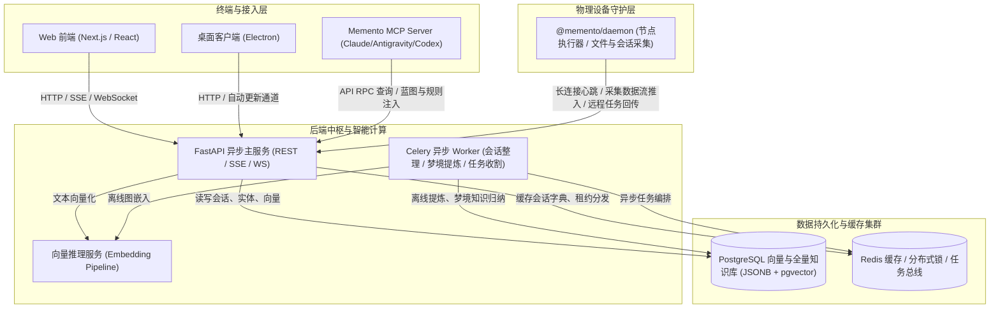

# Project Blueprint: memento

> [!NOTE]
> **Living Blueprint Auto-Generated** · Branch: `main` · Commit: `fe076aa5` · Updated: `2026-11-06`
> This document provides an instant, comprehensive architectural map of the codebase.
> AI coding agents (Antigravity, Claude Code, Codex, Cursor, etc.) can read this blueprint
> at the start of any session for instant global orientation without repetitive grep scans.

## 1. Project Overview & Tech Stack

- **Project Type**: Monorepo (Workspaces)
- **Core Languages**: TypeScript/JavaScript, Python
- **Key Frameworks**: React, FastAPI, SQLAlchemy, Celery, Pydantic, Docker, Kubernetes / Fleet

## 2. High-Level Architecture Topology



## 3. Subsystem Breakdown & Responsibilities

| Subsystem / Path | Category | Role & Purpose |
| :--- | :--- | :--- |
| [`apps/desktop`](apps/desktop) | Application | Memento: the web app in a window, with the local daemon, tray and auto-update |
| [`apps/mobile`](apps/mobile) | Application | mobile application |
| [`apps/web`](apps/web) | Application | web application |
| [`packages/core`](packages/core) | Package / Service | Types, API client and ask stream shared by Memento's web, desktop and mobile clients |
| [`packages/daemon`](packages/daemon) | Package / Service | Memento's local daemon: collects AI tool sessions, runs dispatched agent tasks, keeps the profile and skills in each tool |
| [`packages/mcp`](packages/mcp) | Package / Service | Memento memory over MCP (stdio): search, recall, project context, rules, pitfalls, skills and todos |
| [`server`](server) | Backend API Service | FastAPI backend services, database models, background Celery workers |
| [`embedding`](embedding) | Embedding Microservice | Vector embedding & semantic indexing service |
| [`deploy`](deploy) | Infrastructure & Deployment | Kubernetes kustomization manifests, Fleet GitOps configs, systemd services |

## 4. Key Entry Points & API Endpoints

### Registered FastAPI API Routers

- `/api/admin` (admin.py)
- `/api/ask` (ask.py)
- `/ask_conversations` (ask_conversations.py)
- `/api/auth` (auth.py)
- `/api/conversations` (conversations.py)
- `/api/daily` (daily.py)
- `/api/dashboard` (dashboard.py)
- `/api/data` (data_io.py)
- `/api/devices` (devices.py)
- `/api/documents` (documents.py)
- `/api/events` (events.py)
- `/api/health` (health.py)
- `/api/hierarchy` (hierarchy.py)
- `/api/ingest` (ingest.py)
- `/install_bootstrap` (install_bootstrap.py)
- `/api/learning` (learning.py)
- `/api/life` (life_rhythm.py)
- `/api/profile/llm` (llm.py)
- `/api/media` (media.py)
- `/api/memory` (memory.py)
- `/api/missions` (missions.py)
- `/api/notify` (notify.py)
- `/api/proactive` (proactive.py)
- `/api/profile` (profile.py)
- `/api/projects` (projects.py)
- `/api/public` (public.py)
- `/api/agent/quotas` (quotas.py)
- `/api/search` (search.py)
- `/api/share` (share.py)
- `/api/skills` (skills.py)
- `/api/tasks` (tasks.py)
- `/api/todos` (todos.py)
- `/api/tools` (tools.py)
- `/api/system/update` (updates.py)

### Core Database Models (`models.py`)

`Base`, `Machine`, `MachineMerge`, `Tool`, `Project`, `Document`, `ConversationMessage`, `DailySummary`, `DocumentVersion`, `ConversationMessageRemoved`, `MessageAudit`, `DocumentPendingDelta`, `User`, `InviteCode`, `Permission`, `AccessLog`, `SyncState`, `DocumentEmbedding`, `KnowledgeEntity`, `KnowledgeRelation`, `KnowledgeObservation`, `ShareLink`, `ShareView`, `DeviceTask`, `AskConversation`, `UserMemory`, `DreamJournal`, `UserProfile`, `CorrectionTopic`, `CorrectionEvent`, `SessionReview`, `GuardEvent`, `Skill`, `Todo`, `EvalCase`, `EvalRun`, `LearningEval`, `AgentMission`, `UserLifeRhythm`

## 5. Development & Verification Commands

```bash
# Backend Tests (Python)
cd server && uv run pytest -W error::RuntimeWarning

# Backend Lint
uvx ruff check --isolated --select F server/server

# Frontend Tests & Typecheck (Next.js)
cd apps/web && npx tsc --noEmit && npm test

# Daemon Tests
cd packages/daemon && npm test

# Desktop Tests & Typecheck (Electron)
npm --prefix apps/desktop run typecheck && npm --prefix apps/desktop test
```

## 6. Recent Architectural Evolutions

- `fe076aa5` (2026-11-06): feat(blueprint): 实现多项目会话与任务执行全自动就地配置蓝图及Git钩子
- `5bd93213` (2026-11-06): feat(blueprint): 实现活体代码蓝图自动生成系统与MCP跨Agent协同
- `6a874737` (2026-11-06): perf(web): 优化媒体预览渲染性能并清理页面死状态与升级超时熔断
- `2b5c2dd5` (2026-11-06): refactor(ask): 优化设备过滤匹配逻辑并修复跨设备切换残留与项目引用时序
- `a39349b9` (2026-11-06): fix(title): 修复会话标题Protobuf八进制转义与多轮上下文残留
- `4a0b0c88` (2026-11-06): fix(test): 移除 test_migrate_standalone 中未使用的 os 导入

---
_Auto-maintained by `scripts/project_blueprint.py` & `.git/hooks/post-commit`. Updates automatically on code modifications._
