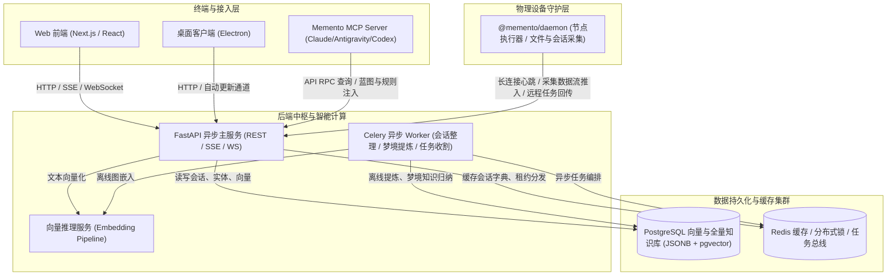

# Project Blueprint: memento

> [!NOTE]
> **Living Blueprint Auto-Generated** · Branch: `main` · Commit: `d1b7b2a9` · Updated: `2026-11-06`
> This document provides an instant, comprehensive architectural map of the codebase.
> AI coding agents (Antigravity, Claude Code, Codex, Cursor, etc.) can read this blueprint
> at the start of any session for instant global orientation without repetitive grep scans.

## 1. Project Overview & Tech Stack

- **Project Type**: Monorepo (Workspaces)
- **Core Languages**: TypeScript/JavaScript, Python
- **Key Frameworks**: React, FastAPI, SQLAlchemy, Celery, Pydantic, Docker, Kubernetes / Fleet

## 2. High-Level Architecture Topology



## 3. Subsystem Breakdown & Responsibilities

| Subsystem / Path | Category | Role & Purpose |
| :--- | :--- | :--- |
| [`apps/desktop`](apps/desktop) | Application | Memento: the web app in a window, with the local daemon, tray and auto-update |
| [`apps/mobile`](apps/mobile) | Application | mobile application |
| [`apps/web`](apps/web) | Application | web application |
| [`packages/core`](packages/core) | Package / Service | Types, API client and ask stream shared by Memento's web, desktop and mobile clients |
| [`packages/daemon`](packages/daemon) | Package / Service | Memento's local daemon: collects AI tool sessions, runs dispatched agent tasks, keeps the profile and skills in each tool |
| [`packages/mcp`](packages/mcp) | Package / Service | Memento memory over MCP (stdio): search, recall, project context, rules, pitfalls, skills and todos |
| [`server`](server) | Backend API Service | FastAPI backend services, database models, background Celery workers |
| [`embedding`](embedding) | Embedding Microservice | Vector embedding & semantic indexing service |
| [`deploy`](deploy) | Infrastructure & Deployment | Kubernetes kustomization manifests, Fleet GitOps configs, systemd services |

## 4. Key Entry Points & API Endpoints

### Frontend Pages & App Router

- `/`
- `/admin`
- `/app`
- `/ask`
- `/auth/callback`
- `/auth/desktop`
- `/auth/handoff`
- `/auth/login`
- `/auth/register`
- `/collector`
- `/conversations/[id]`
- `/daily`
- `/daily/[date]`
- `/devices`
- `/devices/[deviceId]/tools/[toolId]`
- `/devices/[deviceId]/tools/[toolId]/projects/[projectId]`
- `/documents/[id]`
- `/inbox`
- `/memory`
- `/memory/persona`
- `/privacy`
- `/profile`
- `/projects`
- `/projects/[id]`
- `/projects/[id]/conversations`
- `/projects/[id]/timeline`
- `/s/[token]`
- `/search`
- `/skills`
- `/status`
- `/support`
- `/tasks`
- `/tasks/[id]`
- `/tools`
- `/tools/[tool]`

### Registered FastAPI API Routers & Endpoints

#### `/api/admin` (admin.py)

- `GET /api/admin/users`
- `POST /api/admin/users/{user_id}/approve`
- `PUT /api/admin/users/{user_id}`
- `POST /api/admin/users/{user_id}/rotate-collector-token`
- `POST /api/admin/users/{user_id}/transfer-ownership`
- _... (9 more endpoints)_

#### `/api/ask` (ask.py)

- `POST /api/ask/warmup`
- `GET /api/ask/runs`
- `GET /api/ask/runs/active`
- `GET /api/ask/conversations/{conv_id}/run`
- `GET /api/ask/conversations/{conv_id}/stream`
- _... (5 more endpoints)_

#### `/ask_conversations` (ask_conversations.py)

- `GET /ask_conversations/conversations`
- `GET /ask_conversations/conversations/recent-active`
- `GET /ask_conversations/conversations/{conv_id}`
- `POST /ask_conversations/conversations/ensure-by-session`
- `PATCH /ask_conversations/conversations/{conv_id}`
- _... (1 more endpoints)_

#### `/api/auth` (auth.py)

- `GET /api/auth/registration-mode`
- `POST /api/auth/register`
- `POST /api/auth/token-exchange`
- `POST /api/auth/refresh`
- `POST /api/auth/login`
- _... (11 more endpoints)_

#### `/api/conversations` (conversations.py)

- `GET /api/conversations/{doc_id}`
- `GET /api/conversations/{doc_id}/messages`
- `PATCH /api/conversations/{doc_id}`
- `GET /api/conversations/{session_id}/stats`
- `POST /api/conversations/{session_id}/compact`

#### `/api/daily` (daily.py)

- `GET /api/daily`
- `GET /api/daily/{date_str}`
- `GET /api/daily/{date_str}/messages`
- `GET /api/daily/{date_str}/summary`
- `POST /api/daily/{date_str}/generate-summary`

#### `/api/dashboard` (dashboard.py)

- `GET /api/dashboard`

#### `/api/data` (data_io.py)

- `GET /api/data/export`
- `POST /api/data/import`

#### `/api/devices` (devices.py)

- `GET /api/devices`
- `GET /api/devices/{device_db_id}/discovery`
- `DELETE /api/devices/{device_db_id}`
- `POST /api/devices/{device_db_id}/archive`
- `POST /api/devices/{device_db_id}/unarchive`
- _... (6 more endpoints)_

#### `/api/documents` (documents.py)

- `GET /api/documents/proxy-fetch`
- `GET /api/documents/{doc_id}`
- `GET /api/documents/{doc_id}/backlinks`

#### `/api/events` (events.py)

- `GET /api/events/stream`

#### `/api/health` (health.py)

- `GET /api/health/overview`

#### `/api/hierarchy` (hierarchy.py)

- `GET /api/hierarchy/devices`
- `GET /api/hierarchy/devices/{device_id}/tools`
- `GET /api/hierarchy/devices/{device_id}/tools/{tool_id}/projects`
- `GET /api/hierarchy/devices/{device_id}/tools/{tool_id}/files`

#### `/api/ingest` (ingest.py)

- `POST /api/ingest/file`
- `POST /api/ingest/files`
- `POST /api/ingest/reconcile`
- `POST /api/ingest/discovery`
- `POST /api/ingest/heartbeat`
- _... (1 more endpoints)_

#### `/install_bootstrap` (install_bootstrap.py)

- `GET /install_bootstrap/install.sh`
- `GET /install_bootstrap/install.ps1`
- `GET /install_bootstrap/install`
- `GET /install_bootstrap/install`
- `GET /install_bootstrap/install/latest.tar.gz`

#### `/api/learning` (learning.py)

- `GET /api/learning/corrections`
- `POST /api/learning/corrections/{topic_id}/accept`
- `POST /api/learning/corrections/{topic_id}/dismiss`
- `GET /api/learning/check`
- `POST /api/learning/review`
- _... (10 more endpoints)_

#### `/api/life` (life_rhythm.py)

- `GET /api/life/rhythm`
- `POST /api/life/rhythm/sync`
- `POST /api/life/rhythm`
- `POST /api/life/rhythm/parse-image`
- `POST /api/life/rhythm/ocr`
- _... (4 more endpoints)_

#### `/api/profile/llm` (llm.py)

- `GET /api/profile/llm`
- `PUT /api/profile/llm`
- `GET /api/profile/llm/agent`
- `PUT /api/profile/llm/agent`
- `POST /api/profile/llm/test`

#### `/api/media` (media.py)

- `GET /api/media/image/{key:path}`

#### `/api/memory` (memory.py)

- `GET /api/memory/stats`
- `GET /api/memory/resonance`
- `GET /api/memory/graph`
- `GET /api/memory/entities/{entity_id}`
- `GET /api/memory/search`
- _... (17 more endpoints)_

#### `/api/missions` (missions.py)

- `GET /api/missions`
- `POST /api/missions`
- `GET /api/missions/{mission_id}`
- `GET /api/missions/{mission_id}/approve`
- `POST /api/missions/{mission_id}/approve`
- _... (1 more endpoints)_

#### `/api/notify` (notify.py)

- `GET /api/notify/settings`
- `PUT /api/notify/settings`
- `POST /api/notify/device-token`
- `DELETE /api/notify/device-token`
- `POST /api/notify/live-activity-token`
- _... (3 more endpoints)_

#### `/api/proactive` (proactive.py)

- `GET /api/proactive/settings`
- `PUT /api/proactive/settings`
- `POST /api/proactive/test-morning-brief`
- `POST /api/proactive/test-evening-reflection`

#### `/api/profile` (profile.py)

- `GET /api/profile`
- `POST /api/profile/draft/regenerate`
- `PUT /api/profile/draft`
- `DELETE /api/profile/draft`
- `POST /api/profile/publish`
- _... (8 more endpoints)_

#### `/api/projects` (projects.py)

- `GET /api/projects`
- `GET /api/projects/{project_id}`
- `PATCH /api/projects/{project_id}`
- `GET /api/projects/{project_id}/timeline`
- `GET /api/projects/{project_id}/conversations`
- _... (2 more endpoints)_

#### `/api/public` (public.py)

- `GET /api/public/stats`

#### `/api/agent/quotas` (quotas.py)

- `GET /api/agent/quotas`
- `POST /api/agent/quotas/refresh`

#### `/api/search` (search.py)

- `GET /api/search`

#### `/api/share` (share.py)

- `POST /api/share`
- `GET /api/share`
- `GET /api/share/recipients`
- `GET /api/share/inbox`
- `GET /api/share/{token}/views`
- _... (3 more endpoints)_

#### `/api/skills` (skills.py)

- `GET /api/skills`
- `PUT /api/skills/{skill_id}`
- `POST /api/skills/{skill_id}/publish`
- `POST /api/skills/{skill_id}/dismiss`
- `POST /api/skills/{skill_id}/retire`
- _... (5 more endpoints)_

#### `/api/tasks` (tasks.py)

- `POST /api/tasks/dispatch/{device_id}`
- `GET /api/tasks`
- `GET /api/tasks/{task_id}`
- `POST /api/tasks/{task_id}/cancel`
- `POST /api/tasks/{task_id}/input`

#### `/api/todos` (todos.py)

- `GET /api/todos`
- `POST /api/todos`
- `PUT /api/todos/{todo_id}`

#### `/api/tools` (tools.py)

- `GET /api/tools`
- `GET /api/tools/{tool_id}`
- `GET /api/tools/{tool_id}/files`

#### `/api/system/update` (updates.py)

- `GET /api/system/update/check`

### Core Database Models (`models.py`)

`Base`, `Machine`, `MachineMerge`, `Tool`, `Project`, `Document`, `ConversationMessage`, `DailySummary`, `DocumentVersion`, `ConversationMessageRemoved`, `MessageAudit`, `DocumentPendingDelta`, `User`, `InviteCode`, `Permission`, `AccessLog`, `SyncState`, `DocumentEmbedding`, `KnowledgeEntity`, `KnowledgeRelation`, `KnowledgeObservation`, `ShareLink`, `ShareView`, `DeviceTask`, `AskConversation`, `UserMemory`, `DreamJournal`, `UserProfile`, `CorrectionTopic`, `CorrectionEvent`, `SessionReview`, `GuardEvent`, `Skill`, `Todo`, `EvalCase`, `EvalRun`, `LearningEval`, `AgentMission`, `UserLifeRhythm`

## 5. Development & Verification Commands

```bash
# Backend Tests (Python)
cd server && uv run pytest -W error::RuntimeWarning

# Backend Lint
uvx ruff check --isolated --select F server/server

# Frontend Tests & Typecheck (Next.js)
cd apps/web && npx tsc --noEmit && npm test

# Daemon Tests
cd packages/daemon && npm test

# Desktop Tests & Typecheck (Electron)
npm --prefix apps/desktop run typecheck && npm --prefix apps/desktop test
```

## 6. Recent Architectural Evolutions

- `c30c9a69` (2026-11-06): fix(daemon): 修复 blueprint-auto 中 findExecutable 入参类型签名
- `15ffeb07` (2026-11-06): docs(blueprint): 更新活体蓝图快照与多项目全自动部署能力
- `fe076aa5` (2026-11-06): feat(blueprint): 实现多项目会话与任务执行全自动就地配置蓝图及Git钩子
- `5bd93213` (2026-11-06): feat(blueprint): 实现活体代码蓝图自动生成系统与MCP跨Agent协同
- `6a874737` (2026-11-06): perf(web): 优化媒体预览渲染性能并清理页面死状态与升级超时熔断
- `2b5c2dd5` (2026-11-06): refactor(ask): 优化设备过滤匹配逻辑并修复跨设备切换残留与项目引用时序

---
_Auto-maintained by `scripts/project_blueprint.py` & `.git/hooks/(post-commit, post-merge, post-checkout)`. Updates automatically on code modifications, pulls, and branch switches._
