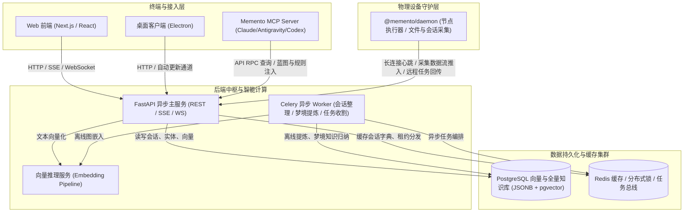
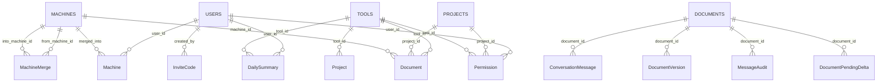

# Project Blueprint: memento

> [!NOTE]
> **Living Blueprint Auto-Generated** · Branch: `main` · Commit: `377feb1f` · Updated: `2026-11-06`
> This document provides an instant, comprehensive architectural map of the codebase.
> AI coding agents (Antigravity, Claude Code, Codex, Cursor, etc.) can read this blueprint
> at the start of any session for instant global orientation without repetitive grep scans.

## 1. Project Overview & Tech Stack

- **Project Type**: Monorepo (Workspaces)
- **Core Languages**: TypeScript/JavaScript, Python
- **Key Frameworks**: React, FastAPI, SQLAlchemy, Celery, Pydantic, Docker, Kubernetes / Fleet

## 2. High-Level Architecture Topology



## 3. Subsystem Breakdown & Responsibilities

| Subsystem / Path | Category | Role & Purpose |
| :--- | :--- | :--- |
| [`apps/desktop`](apps/desktop) | Application | Memento: the web app in a window, with the local daemon, tray and auto-update |
| [`apps/mobile`](apps/mobile) | Application | mobile application |
| [`apps/web`](apps/web) | Application | web application |
| [`packages/core`](packages/core) | Package / Service | Types, API client and ask stream shared by Memento's web, desktop and mobile clients |
| [`packages/daemon`](packages/daemon) | Package / Service | Memento's local daemon: collects AI tool sessions, runs dispatched agent tasks, keeps the profile and skills in each tool |
| [`packages/mcp`](packages/mcp) | Package / Service | Memento memory over MCP (stdio): search, recall, project context, rules, pitfalls, skills and todos |
| [`server`](server) | Backend API Service | FastAPI backend services, database models, background Celery workers |
| [`embedding`](embedding) | Embedding Microservice | Vector embedding & semantic indexing service |
| [`deploy`](deploy) | Infrastructure & Deployment | Kubernetes kustomization manifests, Fleet GitOps configs, systemd services |

## 4. Key Entry Points & API Endpoints

### Frontend Pages & App Router

- `/`
- `/admin`
- `/app`
- `/ask`
- `/auth/callback`
- `/auth/desktop`
- `/auth/handoff`
- `/auth/login`
- `/auth/register`
- `/collector`
- `/conversations/[id]`
- `/daily`
- `/daily/[date]`
- `/devices`
- `/devices/[deviceId]/tools/[toolId]`
- `/devices/[deviceId]/tools/[toolId]/projects/[projectId]`
- `/documents/[id]`
- `/inbox`
- `/memory`
- `/memory/persona`
- `/privacy`
- `/profile`
- `/projects`
- `/projects/[id]`
- `/projects/[id]/conversations`
- `/projects/[id]/timeline`
- `/s/[token]`
- `/search`
- `/skills`
- `/status`
- `/support`
- `/tasks`
- `/tasks/[id]`
- `/tools`
- `/tools/[tool]`

### Registered FastAPI API Routers & Endpoints

#### `/api/admin` (admin.py)

- `GET /api/admin/users`
- `POST /api/admin/users/{user_id}/approve`
- `PUT /api/admin/users/{user_id}`
- `POST /api/admin/users/{user_id}/rotate-collector-token`
- `POST /api/admin/users/{user_id}/transfer-ownership`
- _... (9 more endpoints)_

#### `/api/ask` (ask.py)

- `POST /api/ask/warmup`
- `GET /api/ask/runs`
- `GET /api/ask/runs/active`
- `GET /api/ask/conversations/{conv_id}/run`
- `GET /api/ask/conversations/{conv_id}/stream`
- _... (5 more endpoints)_

#### `/ask_conversations` (ask_conversations.py)

- `GET /ask_conversations/conversations`
- `GET /ask_conversations/conversations/recent-active`
- `GET /ask_conversations/conversations/{conv_id}`
- `POST /ask_conversations/conversations/ensure-by-session`
- `PATCH /ask_conversations/conversations/{conv_id}`
- _... (1 more endpoints)_

#### `/api/auth` (auth.py)

- `GET /api/auth/registration-mode`
- `POST /api/auth/register`
- `POST /api/auth/token-exchange`
- `POST /api/auth/refresh`
- `POST /api/auth/login`
- _... (11 more endpoints)_

#### `/api/conversations` (conversations.py)

- `GET /api/conversations/{doc_id}`
- `GET /api/conversations/{doc_id}/messages`
- `PATCH /api/conversations/{doc_id}`
- `GET /api/conversations/{session_id}/stats`
- `POST /api/conversations/{session_id}/compact`

#### `/api/daily` (daily.py)

- `GET /api/daily`
- `GET /api/daily/{date_str}`
- `GET /api/daily/{date_str}/messages`
- `GET /api/daily/{date_str}/summary`
- `POST /api/daily/{date_str}/generate-summary`

#### `/api/dashboard` (dashboard.py)

- `GET /api/dashboard`

#### `/api/data` (data_io.py)

- `GET /api/data/export`
- `POST /api/data/import`

#### `/api/devices` (devices.py)

- `GET /api/devices`
- `GET /api/devices/{device_db_id}/discovery`
- `DELETE /api/devices/{device_db_id}`
- `POST /api/devices/{device_db_id}/archive`
- `POST /api/devices/{device_db_id}/unarchive`
- _... (6 more endpoints)_

#### `/api/documents` (documents.py)

- `GET /api/documents/proxy-fetch`
- `GET /api/documents/{doc_id}`
- `GET /api/documents/{doc_id}/backlinks`

#### `/api/events` (events.py)

- `GET /api/events/stream`

#### `/api/health` (health.py)

- `GET /api/health/overview`

#### `/api/hierarchy` (hierarchy.py)

- `GET /api/hierarchy/devices`
- `GET /api/hierarchy/devices/{device_id}/tools`
- `GET /api/hierarchy/devices/{device_id}/tools/{tool_id}/projects`
- `GET /api/hierarchy/devices/{device_id}/tools/{tool_id}/files`

#### `/api/ingest` (ingest.py)

- `POST /api/ingest/file`
- `POST /api/ingest/files`
- `POST /api/ingest/reconcile`
- `POST /api/ingest/discovery`
- `POST /api/ingest/heartbeat`
- _... (1 more endpoints)_

#### `/install_bootstrap` (install_bootstrap.py)

- `GET /install_bootstrap/install.sh`
- `GET /install_bootstrap/install.ps1`
- `GET /install_bootstrap/install`
- `GET /install_bootstrap/install`
- `GET /install_bootstrap/install/latest.tar.gz`

#### `/api/learning` (learning.py)

- `GET /api/learning/corrections`
- `POST /api/learning/corrections/{topic_id}/accept`
- `POST /api/learning/corrections/{topic_id}/dismiss`
- `GET /api/learning/check`
- `POST /api/learning/review`
- _... (10 more endpoints)_

#### `/api/life` (life_rhythm.py)

- `GET /api/life/rhythm`
- `POST /api/life/rhythm/sync`
- `POST /api/life/rhythm`
- `POST /api/life/rhythm/parse-image`
- `POST /api/life/rhythm/ocr`
- _... (4 more endpoints)_

#### `/api/profile/llm` (llm.py)

- `GET /api/profile/llm`
- `PUT /api/profile/llm`
- `GET /api/profile/llm/agent`
- `PUT /api/profile/llm/agent`
- `POST /api/profile/llm/test`

#### `/api/media` (media.py)

- `GET /api/media/image/{key:path}`

#### `/api/memory` (memory.py)

- `GET /api/memory/stats`
- `GET /api/memory/resonance`
- `GET /api/memory/graph`
- `GET /api/memory/entities/{entity_id}`
- `GET /api/memory/search`
- _... (17 more endpoints)_

#### `/api/missions` (missions.py)

- `GET /api/missions`
- `POST /api/missions`
- `GET /api/missions/{mission_id}`
- `GET /api/missions/{mission_id}/approve`
- `POST /api/missions/{mission_id}/approve`
- _... (1 more endpoints)_

#### `/api/notify` (notify.py)

- `GET /api/notify/settings`
- `PUT /api/notify/settings`
- `POST /api/notify/device-token`
- `DELETE /api/notify/device-token`
- `POST /api/notify/live-activity-token`
- _... (3 more endpoints)_

#### `/api/proactive` (proactive.py)

- `GET /api/proactive/settings`
- `PUT /api/proactive/settings`
- `POST /api/proactive/test-morning-brief`
- `POST /api/proactive/test-evening-reflection`

#### `/api/profile` (profile.py)

- `GET /api/profile`
- `POST /api/profile/draft/regenerate`
- `PUT /api/profile/draft`
- `DELETE /api/profile/draft`
- `POST /api/profile/publish`
- _... (8 more endpoints)_

#### `/api/projects` (projects.py)

- `GET /api/projects`
- `GET /api/projects/{project_id}`
- `PATCH /api/projects/{project_id}`
- `GET /api/projects/{project_id}/timeline`
- `GET /api/projects/{project_id}/conversations`
- _... (2 more endpoints)_

#### `/api/public` (public.py)

- `GET /api/public/stats`

#### `/api/agent/quotas` (quotas.py)

- `GET /api/agent/quotas`
- `POST /api/agent/quotas/refresh`

#### `/api/search` (search.py)

- `GET /api/search`

#### `/api/share` (share.py)

- `POST /api/share`
- `GET /api/share`
- `GET /api/share/recipients`
- `GET /api/share/inbox`
- `GET /api/share/{token}/views`
- _... (3 more endpoints)_

#### `/api/skills` (skills.py)

- `GET /api/skills`
- `PUT /api/skills/{skill_id}`
- `POST /api/skills/{skill_id}/publish`
- `POST /api/skills/{skill_id}/dismiss`
- `POST /api/skills/{skill_id}/retire`
- _... (5 more endpoints)_

#### `/api/tasks` (tasks.py)

- `POST /api/tasks/dispatch/{device_id}`
- `GET /api/tasks`
- `GET /api/tasks/{task_id}`
- `POST /api/tasks/{task_id}/cancel`
- `POST /api/tasks/{task_id}/input`

#### `/api/todos` (todos.py)

- `GET /api/todos`
- `POST /api/todos`
- `PUT /api/todos/{todo_id}`

#### `/api/tools` (tools.py)

- `GET /api/tools`
- `GET /api/tools/{tool_id}`
- `GET /api/tools/{tool_id}/files`

#### `/api/system/update` (updates.py)

- `GET /api/system/update/check`

### Core Database Models (`models.py`)

`Base`, `Machine`, `MachineMerge`, `Tool`, `Project`, `Document`, `ConversationMessage`, `DailySummary`, `DocumentVersion`, `ConversationMessageRemoved`, `MessageAudit`, `DocumentPendingDelta`, `User`, `InviteCode`, `Permission`, `AccessLog`, `SyncState`, `DocumentEmbedding`, `KnowledgeEntity`, `KnowledgeRelation`, `KnowledgeObservation`, `ShareLink`, `ShareView`, `DeviceTask`, `AskConversation`, `UserMemory`, `DreamJournal`, `UserProfile`, `CorrectionTopic`, `CorrectionEvent`, `SessionReview`, `GuardEvent`, `Skill`, `Todo`, `EvalCase`, `EvalRun`, `LearningEval`, `AgentMission`, `UserLifeRhythm`

#### Key Entity Relationships (Foreign Keys)



- `Machine.user_id` ➔ `users.id`
- `Machine.merged_into` ➔ `machines.id`
- `MachineMerge.from_machine_id` ➔ `machines.id`
- `MachineMerge.into_machine_id` ➔ `machines.id`
- `Project.tool_id` ➔ `tools.id`
- `Document.tool_id` ➔ `tools.id`
- `Document.project_id` ➔ `projects.id`
- `Document.machine_id` ➔ `machines.id`
- `ConversationMessage.document_id` ➔ `documents.id`
- `DailySummary.user_id` ➔ `users.id`
- `DailySummary.tool_id` ➔ `tools.id`
- `DocumentVersion.document_id` ➔ `documents.id`
- `MessageAudit.document_id` ➔ `documents.id`
- `DocumentPendingDelta.document_id` ➔ `documents.id`
- `InviteCode.created_by` ➔ `users.id`
- `Permission.user_id` ➔ `users.id`
- `Permission.project_id` ➔ `projects.id`
- `Permission.tool_id` ➔ `tools.id`
- `Permission.granted_by` ➔ `users.id`
- `AccessLog.user_id` ➔ `users.id`
- `AccessLog.document_id` ➔ `documents.id`
- `SyncState.machine_id` ➔ `machines.id`
- `SyncState.tool_id` ➔ `tools.id`
- `DocumentEmbedding.document_id` ➔ `documents.id`
- `KnowledgeEntity.user_id` ➔ `users.id`

#### Deduplication & Uniqueness Constraints

- `Project.slug` (unique)
- `User.email` (unique)
- `User.collector_token` (unique)
- `User.wechat_openid` (unique)
- `InviteCode.code` (unique)
- `DocumentEmbedding`: unique(document_id, chunk_index)
- `KnowledgeEntity`: unique(user_id, name, entity_type)
- `ShareLink.token` (unique)
- `UserMemory`: unique(user_id, category, key)
- `UserProfile`: unique(user_id, version)
- `CorrectionEvent`: unique(user_id, fingerprint)
- `Skill`: unique(user_id, slug)
- `LearningEval`: unique(user_id, week)

## 5. Core Domain Services & Background Schedules

### Scheduled Background Jobs (Celery Beat / Cron)

| Job Name | Target Task | Schedule |
| :--- | :--- | :--- |
| `daily-digest` | `server.tasks.daily_digest.generate_daily_digest` | `crontab(hour=23, minute=30),  # Run at 23:30 every day` |
| `daily-digest-late` | `server.tasks.daily_digest.generate_daily_digest` | `crontab(hour=3, minute=30)` |
| `nightly-dreaming` | `server.tasks.dreaming_tasks.run_nightly_dreaming` | `crontab(hour=3, minute=0)` |
| `embedding-retry` | `server.tasks.embedding_retry.retry_failed_embeddings` | `crontab(minute="*")` |
| `merge-staged-deltas` | `server.tasks.content_merge.merge_staged_deltas` | `crontab(minute="*")` |
| `message-audit` | `server.tasks.message_audit.audit_messages` | `crontab(minute="3-58/5")` |
| `knowledge-retry` | `server.tasks.knowledge_retry.retry_failed_knowledge` | `crontab(minute="2,17,32,47")` |
| `weekly-db-backup` | `server.tasks.db_backup.run_weekly_backup` | `crontab(hour=3, minute=30, day_of_week="sun")` |
| `title-backfill` | `server.tasks.title_backfill.backfill_titles` | `crontab(minute=7)` |
| `health-check` | `server.tasks.health_check.check_health` | `crontab(minute="5,35")` |
| `close-stale-tasks` | `server.tasks.task_reaper.close_stale_tasks` | `crontab(minute="9,19,29,39,49,59")` |
| `learn-corrections` | `server.tasks.learning_tasks.learn_corrections` | `crontab(minute="*/10")` |
| `learn-todos` | `server.tasks.learning_tasks.learn_todos` | `crontab(minute="4,14,24,34,44,54")` |
| `review-sessions` | `server.tasks.learning_tasks.review_sessions` | `crontab(hour=2, minute=20)` |
| `memory-lifecycle` | `server.tasks.learning_tasks.memory_lifecycle` | `crontab(hour=4, minute=10)` |
| `remind-todos` | `server.tasks.learning_tasks.remind_todos` | `crontab(hour=9, minute=5)` |
| `tsvector-backfill` | `server.tasks.tsvector_backfill.backfill_content_tsv` | `crontab(hour=4, minute=25)` |
| `evaluate-retrieval` | `server.tasks.learning_tasks.evaluate_retrieval` | `crontab(hour=4, minute=40, day_of_week=1)` |
| `evaluate-learning` | `server.tasks.learning_tasks.evaluate_learning` | `crontab(hour=4, minute=50, day_of_week=1)` |

### Core Service Layer Modules

| Service Module | Path | Responsibility |
| :--- | :--- | :--- |
| `agent_limits` | [`server/server/services/agent_limits.py`](server/server/services/agent_limits.py) | An agent's own report that the account's quota ran out: the run then reads as that, not as done, |
| `ai_health` | [`server/server/services/ai_health.py`](server/server/services/ai_health.py) | AI call health: hourly counters in Redis, read back by the health page and alerts. |
| `ai_provider` | [`server/server/services/ai_provider.py`](server/server/services/ai_provider.py) | AI Provider service — multi-provider fallback client. |
| `ai_summary_service` | [`server/server/services/ai_summary_service.py`](server/server/services/ai_summary_service.py) | AI summary service — two-pass daily summary: per-conversation digest → merged daily report. |
| `ask_prompt` | [`server/server/services/ask_prompt.py`](server/server/services/ask_prompt.py) | Prompt assembly for /api/ask: the system prompt, the history window, and |
| `ask_retrieval` | [`server/server/services/ask_retrieval.py`](server/server/services/ask_retrieval.py) | Retrieval for /api/ask: hybrid keyword + vector ranking over the user's |
| `ask_runs` | [`server/server/services/ask_runs.py`](server/server/services/ask_runs.py) | Ask runs that outlive the HTTP request that started them. |
| `ask_store` | [`server/server/services/ask_store.py`](server/server/services/ask_store.py) | Persistence for /api/ask conversations: finding or creating them, appending |
| `ask_stream` | [`server/server/services/ask_stream.py`](server/server/services/ask_stream.py) | Streaming for /api/ask: the direct-agent SSE stream and the response that |
| `cache` | [`server/server/services/cache.py`](server/server/services/cache.py) | Tiered L1 (in-process memory) and L2 (Redis-backed) JSON cache for hot read endpoints. |
| `claude_session` | [`server/server/services/claude_session.py`](server/server/services/claude_session.py) | What resuming a Claude Code session will cost, read from its own transcript. |
| `cluster` | [`server/server/services/cluster.py`](server/server/services/cluster.py) | Coordination between api replicas over Redis. |
| `content_staging` | [`server/server/services/content_staging.py`](server/server/services/content_staging.py) | Appending to a big conversation without rewriting it on every sync. |
| `conversation_parser` | [`server/server/services/conversation_parser.py`](server/server/services/conversation_parser.py) | Unified conversation parser — normalizes different JSONL formats into a common structure. |
| `correction_service` | [`server/server/services/correction_service.py`](server/server/services/correction_service.py) | Learn from corrections as they happen, and measure whether the learning sticks. |
| `device_commands` | [`server/server/services/device_commands.py`](server/server/services/device_commands.py) | Commands for a collector, picked up on its next poll (GET /api/devices/commands). |
| `device_merge` | [`server/server/services/device_merge.py`](server/server/services/device_merge.py) | One computer, one device record. |
| `device_reports` | [`server/server/services/device_reports.py`](server/server/services/device_reports.py) | What connected devices report about themselves: agent capabilities (tools, |
| `device_service` | [`server/server/services/device_service.py`](server/server/services/device_service.py) | Device service — registers and updates collector devices. |
| `dreaming_service` | [`server/server/services/dreaming_service.py`](server/server/services/dreaming_service.py) | Dreaming Consolidation Service — Autonomous Memory Tiering & Sleep Replay. |
| `embedding_service` | [`server/server/services/embedding_service.py`](server/server/services/embedding_service.py) | Embeddings for documents: chunk the text, embed only the chunks that changed. |
| `entity_canon` | [`server/server/services/entity_canon.py`](server/server/services/entity_canon.py) | One knowledge-graph entity per thing. |
| `eval_service` | [`server/server/services/eval_service.py`](server/server/services/eval_service.py) | Retrieval evaluation: does Memento still find the right document? |
| `export_service` | [`server/server/services/export_service.py`](server/server/services/export_service.py) | Account-level data export — builds a portable ZIP of the caller's own data. |
| `geoip` | [`server/server/services/geoip.py`](server/server/services/geoip.py) | Offline GeoIP lookup — reads a MaxMind/DB-IP .mmdb file from disk. |
| `graph_service` | [`server/server/services/graph_service.py`](server/server/services/graph_service.py) | Knowledge graph auto-extraction — extracts entities and relations from conversations using LLM. |
| `guard_service` | [`server/server/services/guard_service.py`](server/server/services/guard_service.py) | Completion check: the Stop hook the collector installs in Claude Code and Codex. |
| `guidance_service` | [`server/server/services/guidance_service.py`](server/server/services/guidance_service.py) | What an AI should know before it acts: the user's rules, past pitfalls, and learned skills. |
| `health_service` | [`server/server/services/health_service.py`](server/server/services/health_service.py) | System health overview: is the learning loop actually working? |
| `import_service` | [`server/server/services/import_service.py`](server/server/services/import_service.py) | Account-level data import — restore a memento-export ZIP into the |
| `ingest_service` | [`server/server/services/ingest_service.py`](server/server/services/ingest_service.py) | Ingest service — processes incoming files from the collector. |
| `jobs` | [`server/server/services/jobs.py`](server/server/services/jobs.py) | Manually triggered long jobs (review now, run the evaluation) with a status the app can poll. |
| `learning_eval_service` | [`server/server/services/learning_eval_service.py`](server/server/services/learning_eval_service.py) | Weekly learning eval: does the user have to correct the AI less over time? |
| `life_service` | [`server/server/services/life_service.py`](server/server/services/life_service.py) | 24/7 Life Rhythm, Screen Time & AI Lifestyle Decision Service. |
| `memory_compaction` | [`server/server/services/memory_compaction.py`](server/server/services/memory_compaction.py) | Memory compaction — periodically compress old observations into summaries. |

## 6. MCP Tools & Real-Time WebSocket Protocols

### Registered MCP Server Tools

| Tool Name | Purpose |
| :--- | :--- |
| `memory_search` | Search your personal AI memory using semantic + full-text hybrid search. Use this to find past conve |
| `memory_recall` | Recall recent memories by category, project, and optional date. |
| `memory_context` | Get project context — meta + the FULL CONTENT of curated docs (identity / memory / plan / learning / |
| `memory_blueprint` | One-shot project blueprint — project meta + FULL content of identity / memory / plan / learning file |
| `memory_store` | Store a new observation or fact in your personal memory. Use this to save important decisions, learn |
| `daily_summary` | Get daily activity summary for a specific date. |
| `memory_open` | Fetch the full content of a document by its ID. Pair this with memory_search / memory_recall — those |
| `memory_conversation` | Read the message-by-message contents of a conversation document, to quote, summarize, or pick up whe |
| `memory_graph` | Explore the knowledge graph around an entity by name: its summary, recent observations, and incoming |
| `memory_core` | Get the user |
| `memory_project_map` | Get a global map of all projects tracked in Memento: title, primary tool and document counts. Use fo |
| `mind_resonance` | 心领神会 (Mind Resonance): Achieve instant mental alignment and heart-to-heart understanding with the us |
| `memory_check_rule` | Pre-flight check against the user |
| `memory_pitfall` | Record a pitfall after you hit a failure, found its cause, and fixed it. Memento warns about it next |
| `memory_skill` | Skills the user approved: procedures that worked in their own environment. With a query (e.g. |
| `todo_list` | The user |
| `todo_add` | Record something the user wants done later (\ |
| `todo_update` | Close or edit a todo. status: done | dropped | open. todo_id: the id (or its first 8 chars) from tod |

### WebSocket Control & Data Plane Events

`connected`, `pong`, `commands_pending`, `get_agent_capabilities`, `get_agent_quotas`, `task_dispatch`, `task_cancel`, `task_input`, `p2p_offer`, `file_stat_req`, `file_chunk_req`, `task_log_resync`

## 7. CI/CD Pipelines, Code Hotspots & Test Suites

### CI/CD Workflows & Deployment Manifests

| Category | Name | Path | Details |
| :--- | :--- | :--- | :--- |
| GitHub Actions | `Android APK` | [`.github/workflows/android.yml`](.github/workflows/android.yml) | Jobs: workflow_call, workflow_dispatch, push, schedule, apk |
| GitHub Actions | `CI` | [`.github/workflows/ci.yml`](.github/workflows/ci.yml) | Jobs: push, pull_request, python, ts-client, ts-mobile, ts-web |
| GitHub Actions | `Build & Deploy (k3s via Fleet)` | [`.github/workflows/deploy.yml`](.github/workflows/deploy.yml) | Jobs: push, workflow_dispatch, changes, wait-ci, build, bump |
| GitHub Actions | `Desktop Release` | [`.github/workflows/desktop-release.yml`](.github/workflows/desktop-release.yml) | Jobs: push, workflow_dispatch, build-electron, android, publish-release, attach-apk |
| K8s / GitOps | `gitrepo.yaml` | [`deploy/fleet/gitrepo.yaml`](deploy/fleet/gitrepo.yaml) | Resources: GitRepo |
| K8s / GitOps | `api.yaml` | [`deploy/k8s/api.yaml`](deploy/k8s/api.yaml) | Resources: Deployment, Service |
| K8s / GitOps | `celery.yaml` | [`deploy/k8s/celery.yaml`](deploy/k8s/celery.yaml) | Resources: Deployment |
| K8s / GitOps | `ingress.yaml` | [`deploy/k8s/ingress.yaml`](deploy/k8s/ingress.yaml) | Resources: Ingress |
| K8s / GitOps | `kustomization.yaml` | [`deploy/k8s/kustomization.yaml`](deploy/k8s/kustomization.yaml) | Resources: Kustomization |
| K8s / GitOps | `web.yaml` | [`deploy/k8s/web.yaml`](deploy/k8s/web.yaml) | Resources: Deployment, Service |

### Automated Test Suite Matrix

| Suite | Directory | Files | Sample Tests |
| :--- | :--- | :--- | :--- |
| Backend (pytest) | [`server/tests`](server/tests) | 89 | `test_agent_limits.py`, `test_agent_run_states.py`, `test_ai_provider.py`, `test_artifact_media_stream.py`, `test_ask_adversarial_challenger.py` |
| Daemon (vitest) | [`packages/daemon/test`](packages/daemon/test) | 32 | `agent-args.test.ts`, `agent-stream.test.ts`, `antigravity-failover.test.ts`, `antigravity-language-server.test.ts`, `antigravity-runner.test.ts` |
| Web (vitest) | [`apps/web/test`](apps/web/test) | 21 | `api-client.test.ts`, `ask-top-bar.test.tsx`, `auth-fetch.test.ts`, `build-update.test.ts`, `cache-writes.test.ts` |
| Desktop (vitest) | [`apps/desktop/test`](apps/desktop/test) | 1 | `helpers.test.ts` |
| MCP (vitest) | [`packages/mcp/test`](packages/mcp/test) | 1 | `server.test.ts` |

### Architectural Hotspots (Top Modified Files in Recent 40 Commits)

- [`apps/web/src/components/ask/HistoryDrawer.tsx`](apps/web/src/components/ask/HistoryDrawer.tsx) (13 commits)
- [`apps/web/src/app/ask/page.tsx`](apps/web/src/app/ask/page.tsx) (12 commits)
- [`server/server/api/ask_conversations.py`](server/server/api/ask_conversations.py) (10 commits)
- [`server/server/main.py`](server/server/main.py) (7 commits)
- [`scripts/project_blueprint.py`](scripts/project_blueprint.py) (5 commits)
- [`server/tests/test_message_store.py`](server/tests/test_message_store.py) (5 commits)
- [`apps/web/src/components/ask/bubbles.tsx`](apps/web/src/components/ask/bubbles.tsx) (4 commits)
- [`apps/web/src/components/viewers/MediaPreview.tsx`](apps/web/src/components/viewers/MediaPreview.tsx) (4 commits)
- [`packages/daemon/src/task-runner.ts`](packages/daemon/src/task-runner.ts) (4 commits)
- [`server/server/db/models.py`](server/server/db/models.py) (4 commits)

## 8. Development & Verification Commands

```bash
# Backend Tests (Python)
cd server && uv run pytest -W error::RuntimeWarning

# Backend Lint
uvx ruff check --isolated --select F server/server

# Frontend Tests & Typecheck (Next.js)
cd apps/web && npx tsc --noEmit && npm test

# Daemon Tests
cd packages/daemon && npm test

# Desktop Tests & Typecheck (Electron)
npm --prefix apps/desktop run typecheck && npm --prefix apps/desktop test
```

## 9. Recent Architectural Evolutions

- `377feb1f` (2026-11-06): feat(ask): 实现 Antigravity 模型实时动态拉取与多语言蓝图实体关系扫描
- `b15a4962` (2026-11-06): feat(blueprint): 增加核心外键实体链路提取、环境变量字典扫描与Agent指引自锚定
- `c7ed3f39` (2026-11-06): feat(blueprint): 升级多钩子生命周期自同步、前端AppRouter路由扫描与详细API契约提取
- `c30c9a69` (2026-11-06): fix(daemon): 修复 blueprint-auto 中 findExecutable 入参类型签名
- `15ffeb07` (2026-11-06): docs(blueprint): 更新活体蓝图快照与多项目全自动部署能力
- `fe076aa5` (2026-11-06): feat(blueprint): 实现多项目会话与任务执行全自动就地配置蓝图及Git钩子

## 10. Key Environment Variables & Configuration

| Variable | Default / Status | Description |
| :--- | :--- | :--- |
| `MEMENTO_SECRET_KEY` | `(required secret)` | Signs JWTs. Must be >= 32 chars, high entropy. |
| `MEMENTO_COLLECTOR_TOKEN` | `(required secret)` | Token used by collectors to register themselves. |
| `POSTGRES_PASSWORD` | `(required secret)` | Postgres superuser password (keep in sync with MEMENTO_DATABASE_URL). |
| `MINIO_ROOT_USER` | `(required secret)` | MinIO / S3 credentials. |
| `MINIO_ROOT_PASSWORD` | `(required secret)` | Environment configuration |
| `ANTHROPIC_API_KEY` | `(required secret)` | Anthropic Claude (for `/api/daily/*/generate-summary`). Leave blank to disable. |
| `MEMENTO_AI_API_KEY` | `(required secret)` | Leave blank to disable the alt backend. |
| `MEMENTO_AI_BASE_URL` | `https://coding.dashscope.aliyuncs.com/v1` | Environment configuration |
| `MEMENTO_AI_MODEL` | `kimi-k2.5` | Environment configuration |
| `MEMENTO_EMBEDDING_SERVER_URL` | `http://host.docker.internal:8002` | MEMENTO_EMBEDDING_SERVER_URL=http://<internal-ip>:8002 |

---
_Auto-maintained by `scripts/project_blueprint.py` & `.git/hooks/(post-commit, post-merge, post-checkout)`. Updates automatically on code modifications, pulls, and branch switches._
